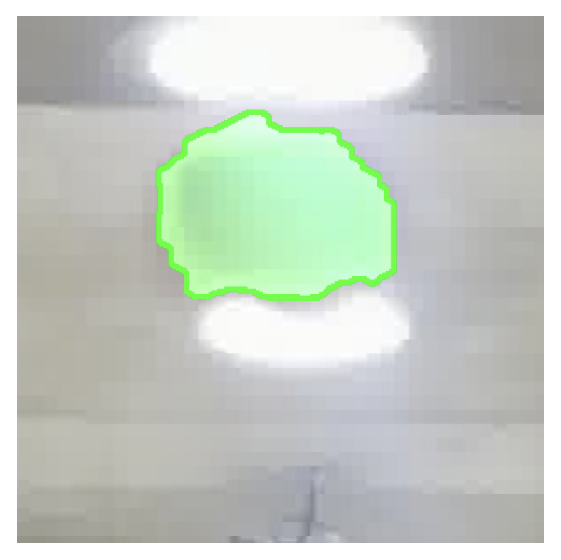
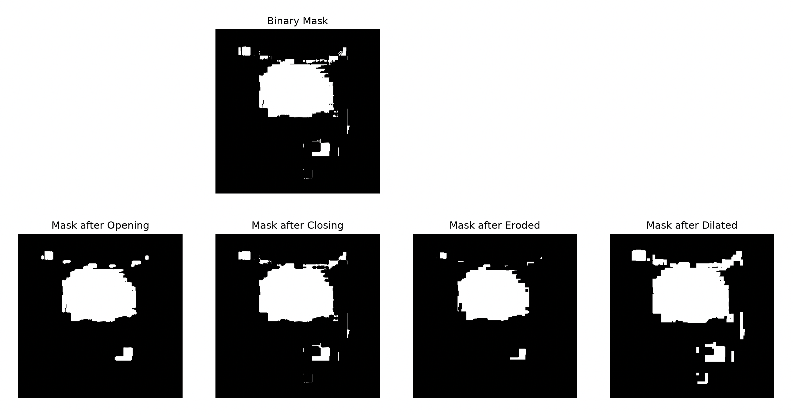
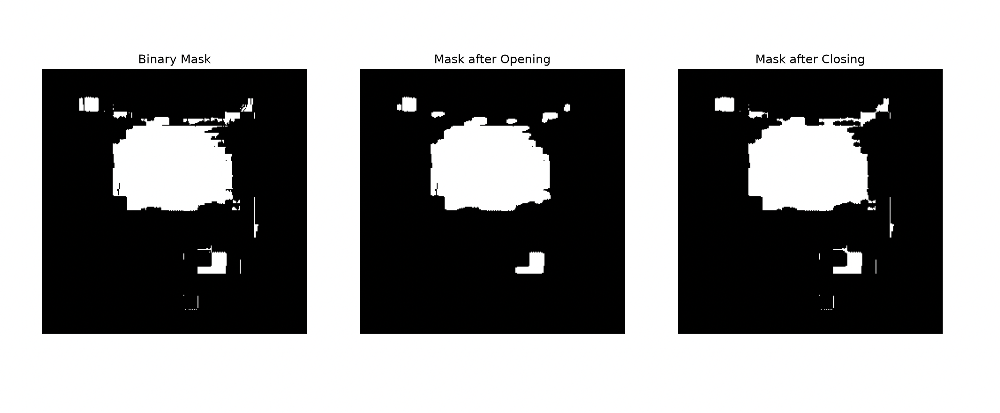
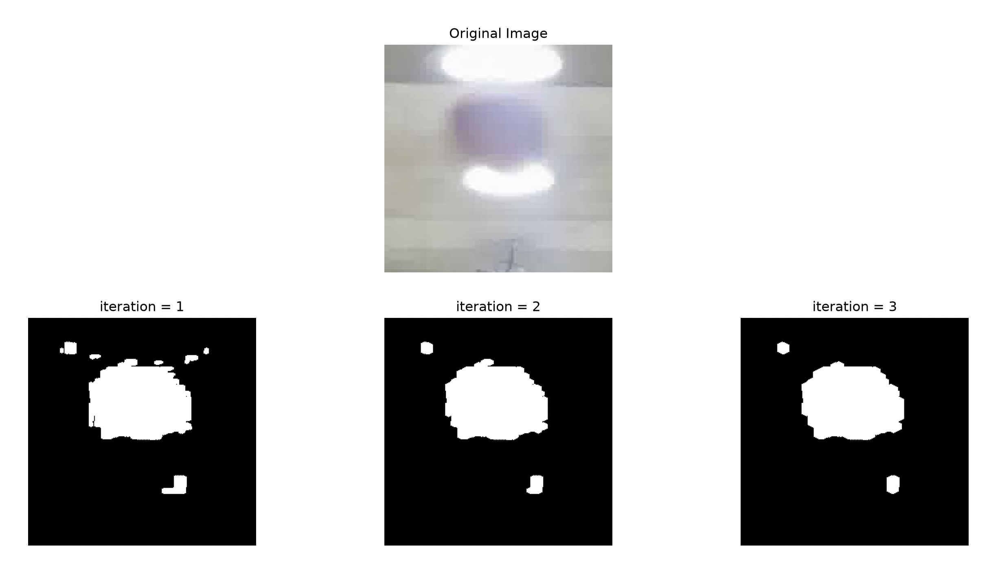
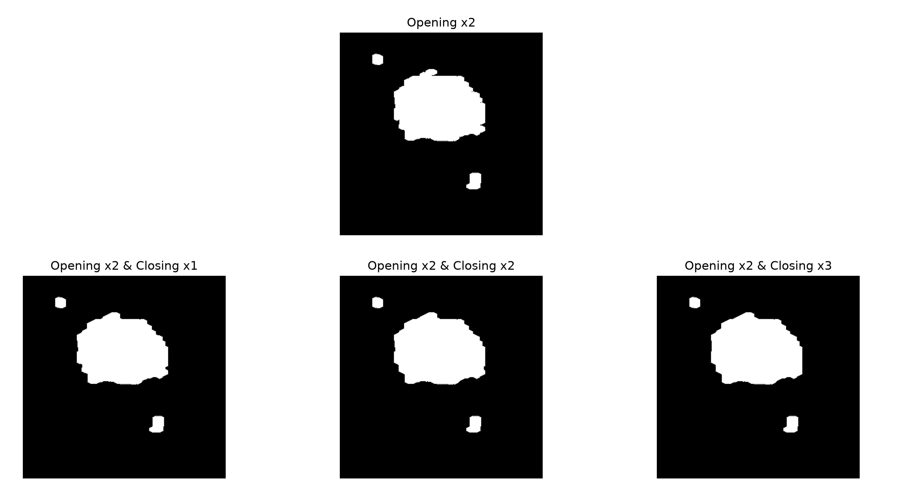

# 261017 과제 - 농구공 외곽선 검출

"02_Computer-Vision.ipynb" 의 오토바이 예시로 배운 방법을, 조명 오염이 심한 농구공 이미지에 동일하게 적용한 과제입니다.



## 1. 파일 구조와 역할

```
Vision-LLM-202138150/
├── src/
│   └── images/
│       └── basketball_crop.jpg      # 입력 이미지 (조명 오염이 심한 농구공)
└── 261017/
    ├── 261017_task.py               # 과제 코드
    ├── README.md                    # 이 문서
    ├── opening&closing.png          # Opening vs Closing 비교 결과
    ├── openingx.png                 # Opening 횟수 비교 결과
    ├── openingx2&closing.png        # Closing 횟수 비교 결과
    └── final_img.png                # 최종 결과
```

## 2. 동작 과정

- 이미지 불러오기 (BGR → RGB)
- LAB변환, CLAHE 생성 후 Lightness 강화하여 이진 마스크 생성
- 최종 binary mask 생성 (결정)
  - Opening과 Closing 중 무엇이 더 나은지 비교
  - Opening 횟수 비교
  - Opening x2 결과에 Closing 횟수 비교
- Binary mask로 외곽선 검출
- 최종 농구공 영역 및 외곽선 선택
  - 가장 큰 contour만 채운 binary mask 생성
  - Binary mask를 반투명 초록색으로 overlay
  - Contour 그리기 (초록색 외곽선)

## 3. 실행 방법

```bash
cd Vision-LLM-202138150/261017
python 261017_task.py
```

- 이미지 경로 : ../src/images/basketball_crop.jpg
- 실행 위치 : 261017 폴더 안
- 필요한 라이브러리: opencv-python, numpy, matplotlib

## 4. 예상 출력

### TODO: Morphological operation을 적용하여 최종 binary mask 생성

**0. Erosion vs Dilation vs Opening vs Closing**



**1. Opening vs Closing**



**2. Opening 횟수 비교**



**3. Opening x2 + Closing 횟수 비교**



### TODO: Binary mask로 외곽선 검출
최종 마스크에서 외곽선 목록을 만들며, 농구공 1개와 작은 노이즈 덩어리 2개가 검출됩니다.

### TODO: 최종 농구공 영역 및 외곽선 선택
가장 큰 외곽선만 선택하여, 농구공 영역에 반투명 초록색을 덮고 초록색 외곽선을 그린 결과가 출력됩니다. 노이즈 덩어리 2개는 이 단계에서 제외됩니다.


## 5. 아이디어와 구현 내용

### 적용한 아이디어
- 오토바이는 HSV만으로 빨간 영역이 잘 잡혔지만, 농구공은 조명 때문에 채도가 낮아 HSV로는 거의 잡히지 않았다.
  - 그래서 G. Image Enhancement를 참고하여 LAB 생성 및 CLAHE를 사용하였다.
  - 마스크를 만든 뒤에는 오토바이 예시와 같은 흐름(Opening/Closing 비교 → 횟수 비교 → 외곽선 검출 → 가장 큰 외곽선 선택)을 따랐다.
- CLAHE는 L 채널에만 적용
  - 밝기 대비만 강화하고 색 정보(a, b)는 그대로 유지하기 위해 split으로 나눈 뒤 L만 CLAHE를 적용하고 다시 merge했다.
- 타원형 커널(5x5) 사용
  - 농구공이 둥근 형태이므로 사각형 커널 대신 MORPH_ELLIPSE를 사용했다.

### 구현한 부분
- LAB과 CLAHE 기반 binary mask를 생성하였다.
- Opening/Closing 및 반복 횟수 비교 과정을 넣었고, 이의 결과를 이미지로 캡처하여 README에 첨부하였다.
- Erosion vs Dilation vs Opening vs Closing 비교도 진행하여, 결과를 이미지로 캡쳐하여 README에 첨부하였다.
- 외곽선 검출을 하고, 가장 큰 외곽선 선택까지 구현하였으며, 원본 이미지 위에 오버레이하였다.

### 구현하지 못한 부분
- LAB 범위는 노트북에서 주어진 값을 그대로 사용했고, 직접 최적값을 찾지는 못하였다.
- Closing 반복 횟수 비교를 통한 결과 선택은 주관적인 경향이 강했다. 객관적인 수치로 판단하는 것은 구현하지 못하였다.

## 6. 모폴로지 선택 근거

### 1. Opening과 Closing 중 무엇이 더 나은지 비교 -> 노이즈가 더 적어서 Opening으로 결정
- **Opening :** 공 오른쪽 위의 가는 줄무늬 노이즈와 흩어진 작은 점들이 대부분 제거됐다.
- **Closing :** 노이즈가 그대로 남거나 서로 붙어서, 공 오른쪽 테두리가 오히려 지저분해졌다.

### 2. Opening 횟수 비교 -> iteration = 2와 3이 비슷하지만, 면적이 더 넓어보이는 2로 결정
- **1회:** 공 위쪽에 작은 노이즈 조각이 여러 개 남아 있다.
- **2회, 3회:** 남은 노이즈(왼쪽 위 작은 점, 아래쪽 블록)는 비슷하지만, 3회는 공 테두리까지 더 깎여 공 영역이 작아졌다.
- 노이즈는 충분히 지우면서 공 면적은 최대한 보존하는 2회로 결정했다.

### 3. Opening x2 결과에 Closing 횟수 비교 -> 다 비슷해보이지만, 횟수가 많을수록 테두리가 조금씩 매끄러워져서 Closing x3으로 결정
- 1~3회 모두 결과 차이는 크지 않지만, 횟수가 늘수록 공 오른쪽 테두리가 조금씩 매끄러워졌다.
- 외곽선을 매끄럽게 검출하기 위해 3회로 결정했다.

### 최종 조합: Opening x2 → Closing x3

## 7. 한계
- 노이즈가 공보다 크거나 공이 여러 개면 잘못 선택할 수 있다.
- 조명 반사 때문에 외곽선이 완전한 원이 아니라 조금 신기한 모양으로 검출되었다.
