# 261025 과제 - 딥러닝 및 GPU 가속

`03_DL-and-GPU.ipynb`의 모델 성능 확인부터 CuPy convolution 연산까지의 TODO를 구현한 과제입니다.

앞에서 배운 CNN 학습 코드와 Feature Map 시각화 함수를 사용하고, NumPy와 CuPy로 이미지 잔상 효과와 convolution을 구현하여 CPU와 GPU의 결과 및 처리 시간을 비교하는 과제를 수행하였습니다.

<p align="center">
  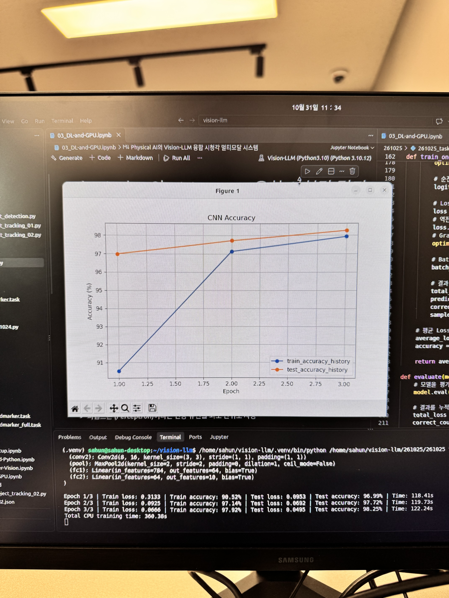
  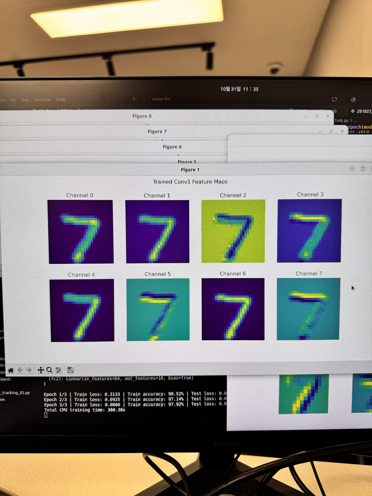
  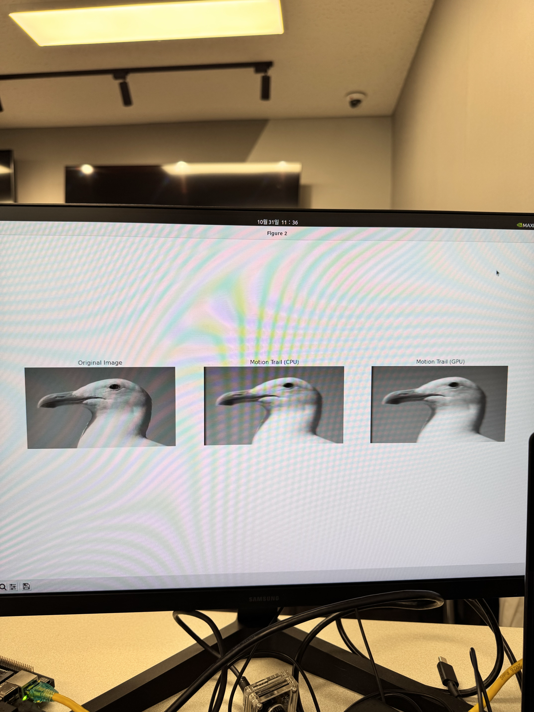
  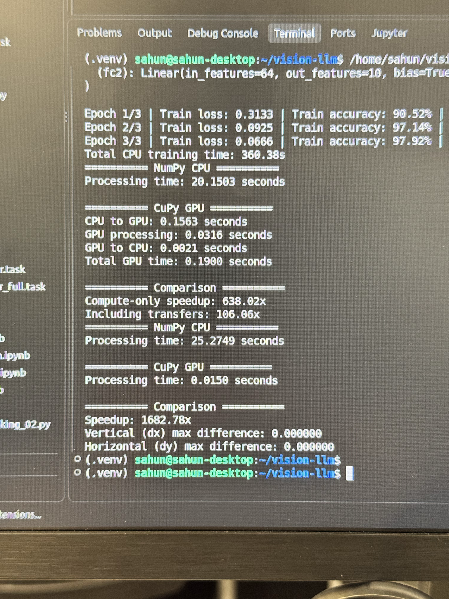
</p>

## 1. 파일 구조와 역할

```text
261025/
├── 261025_task.py       # 실습 준비 코드와 TODO 풀이
├── README.md            # 이 문서
└── src/
    └── images/
        └── seagull.jpg  # 입력 이미지
```

- `261025_task.py`에는 필요한 import, 함수, 모델 정의, 데이터 로딩과 학습 코드가 들어 있습니다.
- MNIST 데이터는 최초 실행 시 `src/datasets`에 다운로드됩니다.
- `src/images/seagull.jpg` 이미지 파일도 폴더에 넣어서, 261025 폴더 만으로도 파일을 실행할 수 있도록 만들었습니다.

## 2. 동작 과정 및 결과 사진

### 모델 성능 확인

- 기존 `SimpleCNN`, `train_one_epoch()`, `evaluate()`를 사용해 MNIST를 CPU에서 3 Epoch 학습하고 평가합니다.
- 각 Epoch의 Train/Test Loss와 Accuracy를 저장하고, 학습 결과와 소요 시간을 출력합니다.
- 저장한 기록으로 Loss와 Accuracy 그래프를 출력합니다.
- Accuracy는 NumPy 배열로 변환한 뒤 100을 곱해 백분율로 표시합니다.

<p align="center">
  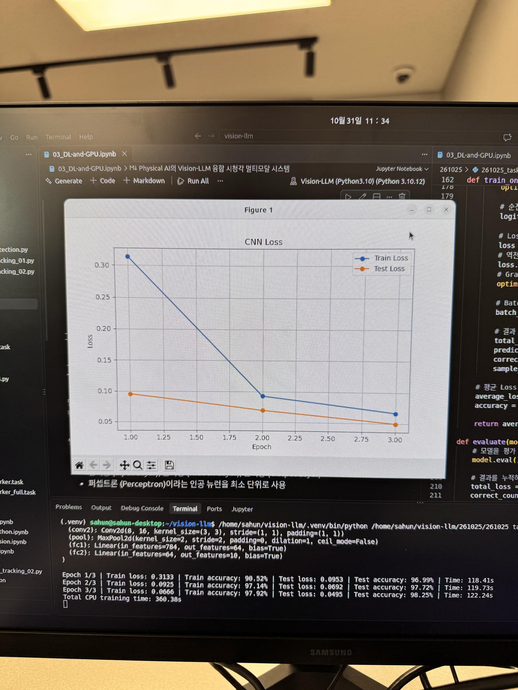
  
</p>

- Loss 변화 : Epoch가 증가하면서 Train Loss는 0.3133에서 0.0666으로, Test Loss는 0.0953에서 0.0495로 감소했습니다. 학습 데이터뿐 아니라 테스트 데이터에서도 Loss가 감소하는 것을 확인했습니다.
- Accuracy 변화 : Train Accuracy는 90.52%에서 97.92%로, Test Accuracy는 96.99%에서 98.25%로 증가했습니다. 3 Epoch 동안 학습이 진행되면서 분류 정확도가 높아졌으며, CPU에서 전체 학습에 걸린 시간은 약 360.38초였습니다.

### 학습된 모델의 Feature Map 확인

- 테스트 이미지 한 장을 선택하고 Batch 차원을 추가합니다.
- `model.eval()`과 `torch.no_grad()`를 사용해 평가 모드에서 Gradient 계산 없이 순전파합니다.
- `return_features=True`로 각 층의 중간 출력을 가져옵니다.
- 기존 `show_feature_maps()`를 사용해 Conv1은 8개, Conv2는 16개를 출력합니다.
- conv1, relu1, pool1, conv2, relu2, pool2는 각각 4개씩 출력하여 비교합니다.
- 색상은 `viridis`를 사용합니다.

<p align="center">
  
  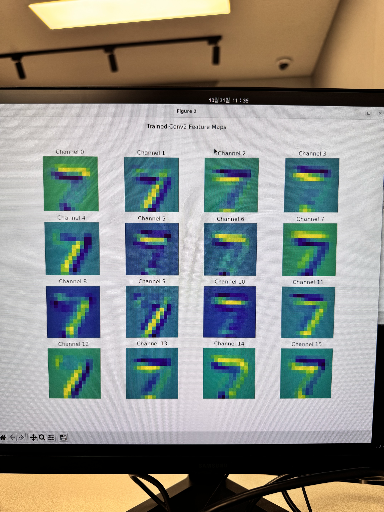
  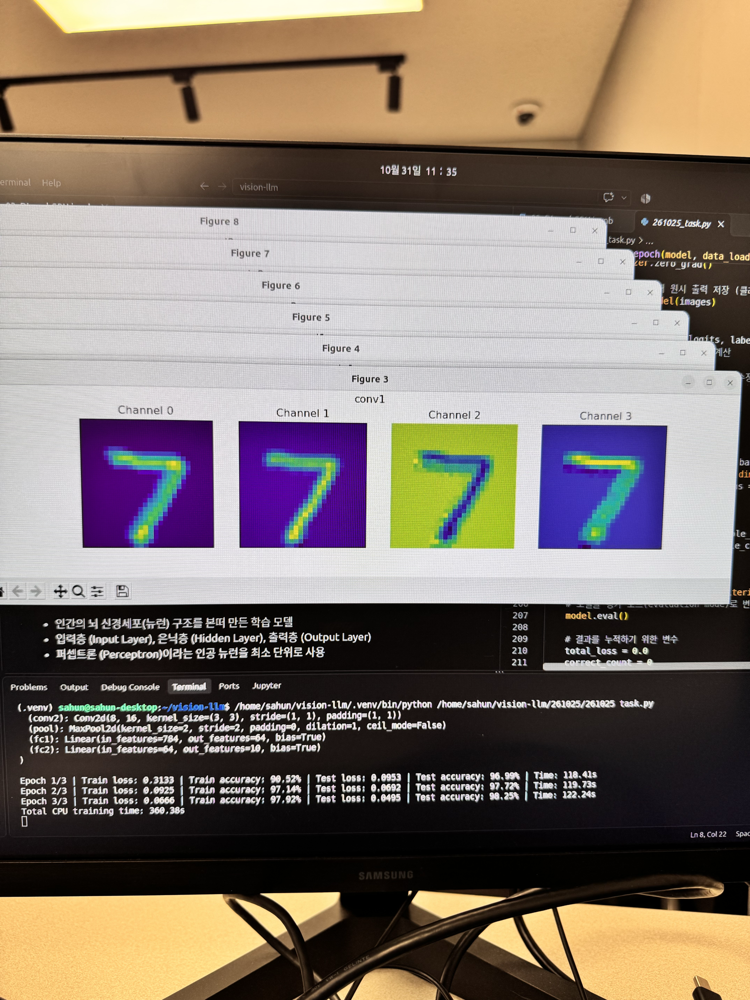
  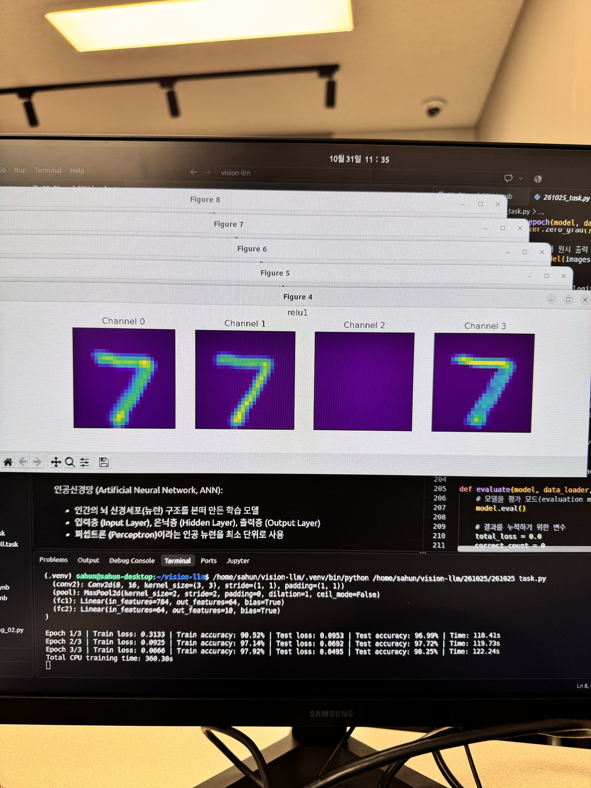
</p>

<p align="center">
  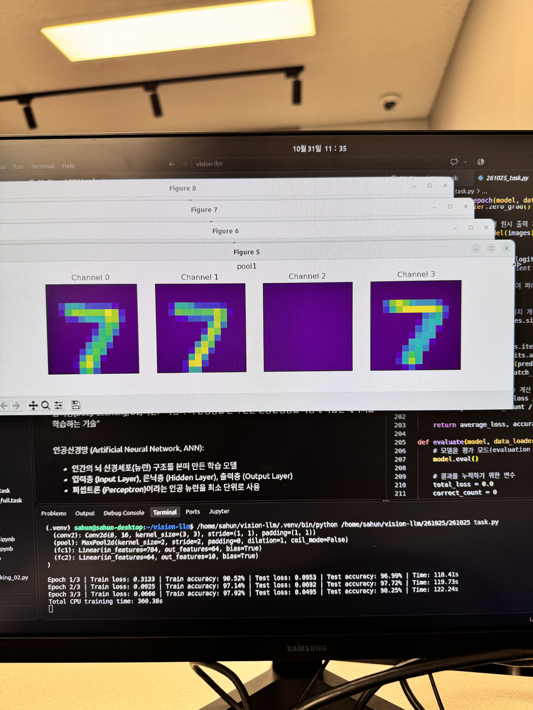
  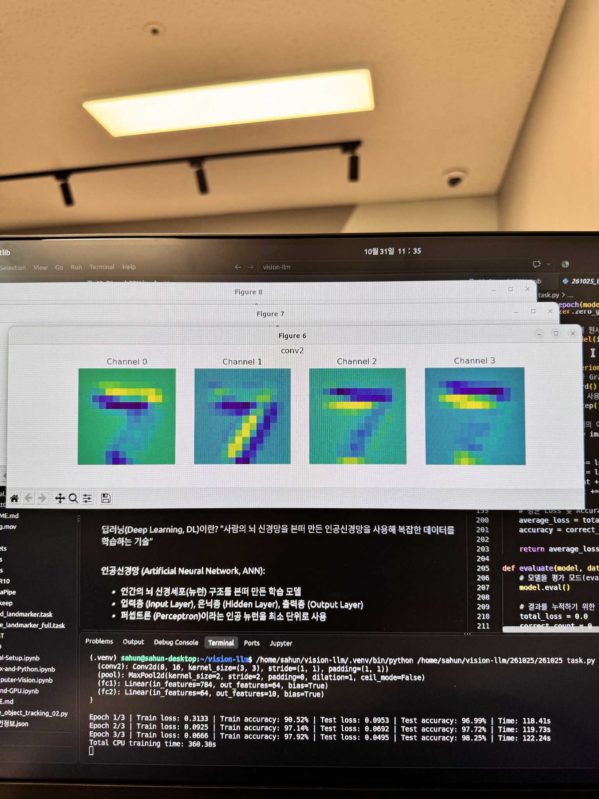
  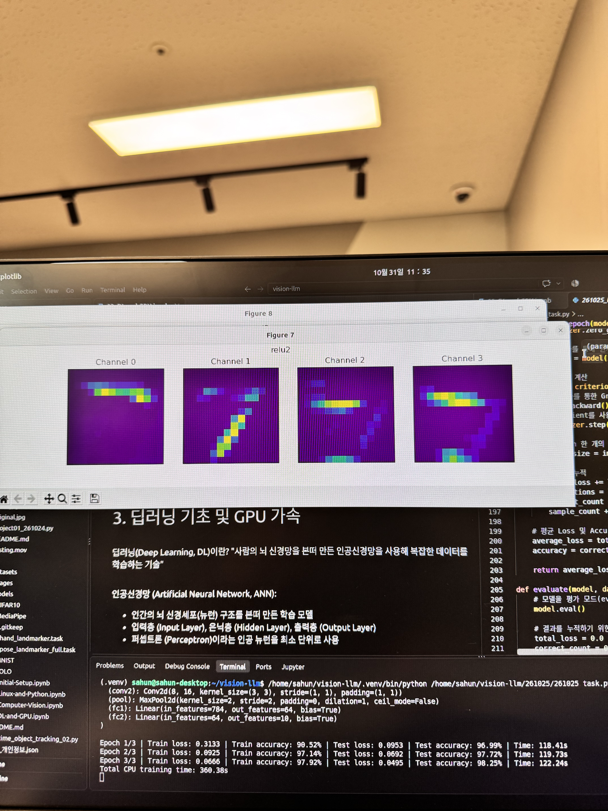
  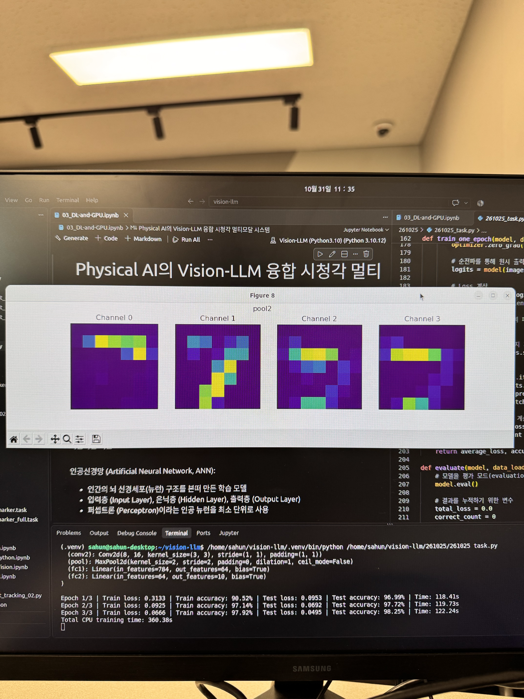
</p>

- 첫 번째 convolution 결과에서는 숫자 7의 가로획과 대각선 형태가 나타났습니다. 같은 이미지를 입력해도 채널마다 강조되는 부분과 출력 형태가 다르게 나타나는 것을 확인했습니다.
- 두 번째 convolution 결과에서는 채널에 따라 가로획이나 대각선의 일부가 강조됐습니다. 앞부분에서 추출한 특징이 다음 convolution을 거치면서 서로 다른 형태로 나타났습니다.
- 다음으로는 첫 번째 convolution의 대표 채널 4개를 비교했습니다. 숫자 7의 전체적인 형태가 유지되면서도 채널별로 출력 차이가 나타났습니다.
- ReLU 적용 후 음수 출력이 0으로 바뀌었습니다. 특히 Channel 2는 해당 이미지에 대한 출력 전체가 0으로 처리되어 단색으로 나타났습니다.
- 5번째 사진에서는 Max Pooling으로 Feature Map의 크기가 28×28에서 14×14로 줄었습니다. 세부 표현은 거칠어졌지만, 활성화된 채널에서는 숫자의 주요 형태가 유지됐습니다.
- 두 번째 convolution의 대표 채널 4개를 비교했습니다. 가로획과 대각선 부분에 대한 반응이 채널마다 다르게 나타났습니다.
- ReLU를 적용하면서 음수 출력이 제거되고, 각 채널에서 양수로 반응한 부분이 남았습니다. 채널별로 남아 있는 영역이 다르게 나타났습니다.
- 마지막으로, 두 번째 Max Pooling을 통해 크기가 14×14에서 7×7로 줄었습니다. 세부 모양은 단순해졌지만, 각 채널에서 강하게 반응한 영역은 남는 것을 확인했습니다.

### 이미지 잔상 효과 구현

- 갈매기 이미지를 흑백으로 불러오고 1280×720 크기로 조정합니다.
- 픽셀값을 float32의 0~1 범위로 변환합니다.
- 오른쪽으로 이동할수록 작아지는 가중치 32개를 만들고, 합이 1이 되도록 정규화합니다.
- NumPy에서는 출력 픽셀을 하나씩 계산합니다.
- CuPy에서는 이동량만 반복하고, 각 이동 단계의 픽셀 계산은 배열 전체에 적용합니다.
- CPU 처리 시간, GPU 처리 시간, CPU와 GPU 사이의 복사 시간을 출력합니다.
- 복사 시간을 제외한 가속 배율과 포함한 가속 배율을 각각 구합니다.
- 원본, CPU 잔상, GPU 잔상 이미지를 출력하여 비교합니다.

<p align="center">
  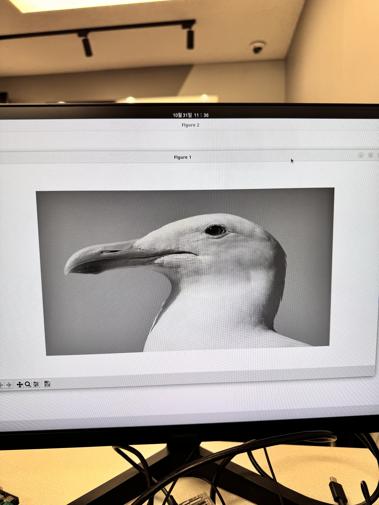
  
  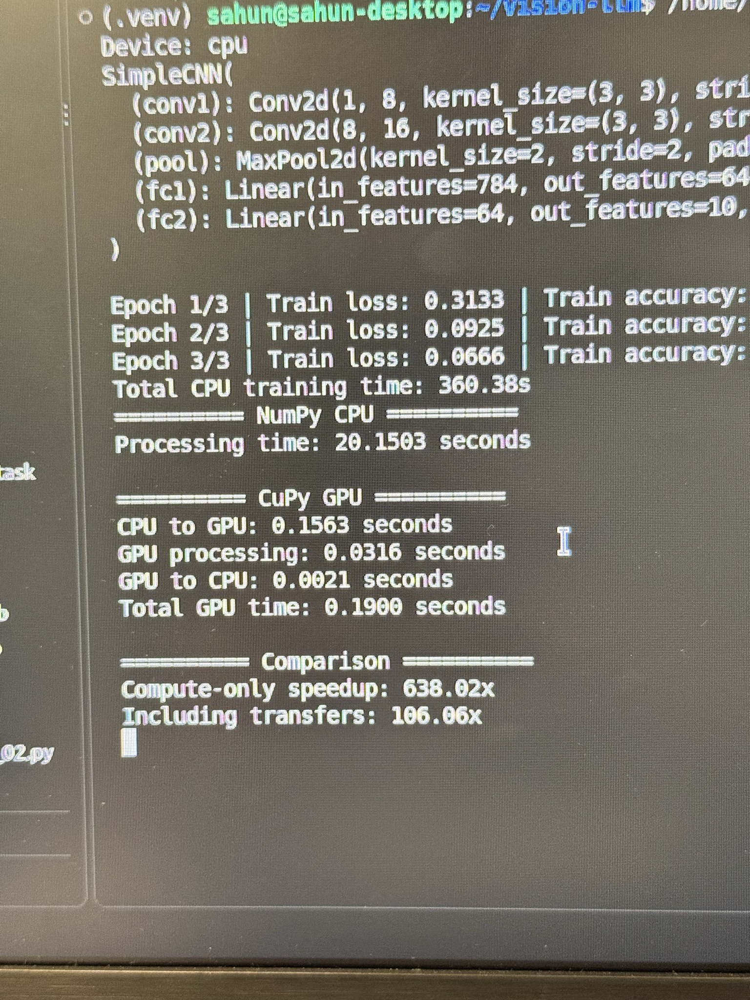
</p>

- 첫 번째 사진은 잔상 효과를 적용하기 전의 흑백 이미지입니다. 갈매기의 눈, 부리와 머리 경계가 비교적 선명하게 나타납니다.
- 두 번째 사진에서는 잔상 효과를 적용한 뒤에 원본보다 경계가 가로 방향으로 퍼지고 흐려졌습니다. CPU와 GPU 결과는 사진상으로 거의 같은 잔상 형태를 보였습니다.
- 결과 터미널에서는 CPU 처리 시간은 약 20.1503초, GPU 처리 시간은 약 0.0316초였으며, 계산 시간 기준으로 약 638.02배의 가속이 기록됐습니다.
- 데이터 복사 시간을 포함한 GPU 전체 시간은 약 0.1900초였고, 이때 가속 배율은 약 106.06배였습니다. 복사 시간을 포함하면 가속 배율이 낮아져, 데이터 이동 시간도 전체 처리 시간에 영향을 준다는 것을 확인했습니다.

### Convolution 연산

- 실습에서 사용한 가로, 세로 edge 필터와 편향을 사용합니다.
- CPU에서는 기존 `convolution2d()`를 사용합니다.
- GPU에서는 커널 원소를 하나씩 선택하고, 대응하는 입력 영역 전체에 가중치를 곱해 누적합니다.
- 0으로 채운 배열에 입력 이미지를 넣어서 zero padding을 구성합니다.
- 두 구현 모두 `stride=1`, `padding=1`로 계산합니다.
- GPU 결과를 `cp.asnumpy()`로 복사한 뒤 기존 `relu()`를 적용합니다.
- CPU/GPU 처리 시간과 가속 배율을 출력합니다.
- ReLU를 적용한 결과끼리 최대 절대 차이를 구하고, 가로·세로 edge 이미지를 비교합니다.

<p align="center">
  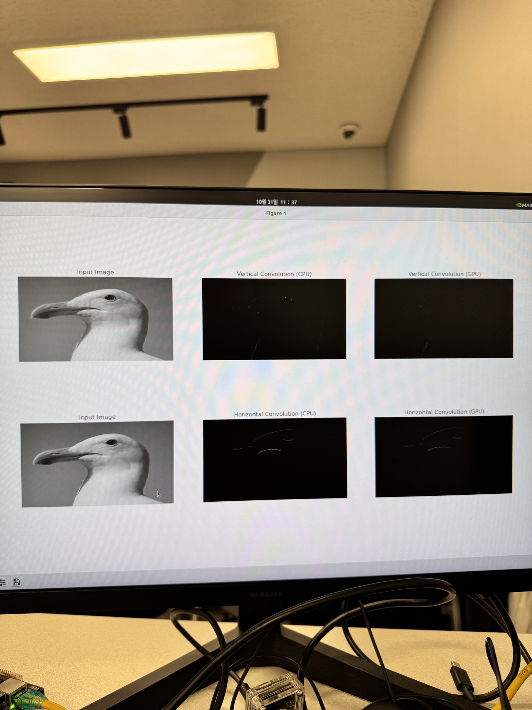
  
</p>

- 방향별 필터를 적용한 결과, 갈매기 이미지에서 일부 경계가 검출됐습니다. 결과는 대부분 어둡고 일부 경계만 희미하게 나타났습니다. 음수 편향과 ReLU를 적용하면서 약한 반응과 음수 출력이 제거된 결과로 해석할 수 있습니다.
- CPU 처리 시간은 약 25.2749초, GPU 처리 시간은 약 0.0150초였으며, 출력된 가속 배율은 약 1682.78배였습니다.
- ReLU 적용 후 최대 절대 차이는 가로, 세로 방향 모두 0.000000으로 출력됐습니다. 출력된 소수점 여섯 자리 기준으로 CPU와 GPU 결과의 차이가 나타나지 않았음을 볼 수 있습니다.

## 3. 실행 방법

`261025_task.py`가 있는 폴더 안에서 실행합니다.

```bash
python 261025_task.py
```

- 입력 이미지 경로: `src/images/seagull.jpg`
- 필요한 라이브러리: numpy, matplotlib, opencv-python, torch, torchvision, cupy
- `time`, `random`은 Python 기본 라이브러리입니다.
- MNIST는 최초 실행 시 다운로드하므로, 인터넷 연결이 요구됩니다.
- CuPy와 CUDA를 사용할 수 있는 NVIDIA GPU 환경이 필요합니다.
- 그래프 창이 표시되면 확인 후 닫아야 다음 코드가 실행됩니다.
- 결과는 Matplotlib으로 출력하며, 이미지 파일로 자동 저장하지는 않습니다.

## 4. 아이디어와 구현 내용

### 앞부분 코드 활용

- 성능 그래프는 기존 `plt.plot()`을 사용하고, 정확도 변환은 `np.array()`와 배열 곱셈을 사용했습니다.
- Feature Map은 기존 `show_feature_maps()`를 반복해서 호출하도록 했습니다.
- NumPy 잔상 함수는 앞의 convolution 코드에서 사용한 배열 크기 확인, 출력 배열 생성, 중첩 반복문과 인덱싱 방식을 활용했습니다.
- CuPy 잔상과 convolution은 기본 슬라이싱과 배열 곱셈, 누적으로 계산했습니다.
- GPU 배열을 만들 때는 `np.zeros()`에 대응하는 `cp.zeros()`를 사용했습니다.
- 배열 변환과 시간 측정은 실습의 `cp.asarray()`, `cp.asnumpy()`, `time.perf_counter()`와 동기화를 활용했습니다.

### 구현한 부분

- 잔상 계산에서 이미지 밖의 픽셀은 `if input_x >= 0` 조건으로 제외했습니다.
- CuPy 잔상은 이동량이 이미지 너비보다 작은 경우만 계산하고, 결과를 출력 배열의 슬라이스에 직접 대입했습니다.
- GPU convolution은 과제에서 사용하는 `stride=1`에 맞춰 기본 슬라이싱으로 구현했습니다.
- 절대 차이는 `np.maximum(차이, -차이)`로 구하고, `np.max()`로 가장 큰 값을 선택했습니다.
- CPU 처리 시간은 convolution 실행 전후의 시각을 저장한 뒤 차이를 구했습니다.
- GPU는 워밍업 후 계산하고, 동기화를 통해 연산이 끝난 시점까지 시간을 측정했습니다.

## 5. 한계와 참고 사항

- GPU convolution은 `stride=1`에서 사용해야 합니다. 다른 stride 값을 막는 조건은 없으며, 다른 값을 넣으면 잘못된 결과가 나올 수 있습니다.
- Convolution의 최대 절대 차이는 ReLU 적용 후 결과를 비교한 값입니다.
- Convolution 시간에는 두 방향 필터 계산만 포함하고, ReLU, 결과 복사와 시각화는 제외합니다.
- CPU는 픽셀별 반복문을 사용하고 GPU는 배열 전체를 계산하므로, 가속 배율에는 장치 성능뿐 아니라 계산 방식의 차이도 포함됩니다.
- 실제 학습 결과와 GPU 처리 시간은 실행 환경에 따라 달라질 수 있습니다.
- 과제 수행은 Google Colab에서 진행하였습니다. 런타임 유형을 T4 GPU로 변경하여 CUPY 같은 GPU 연산 기능들도 사용할 수 있도록 테스트해보았습니다.
- 최종 테스트는 실습실의 엔비디아 젯슨 오린 나노에서 직접 진행해보았습니다. 진행한 결과를 찍어서 기록으로 남겼습니다.

<br>

---

# 추가 과제 - GPU 가속 학습, 모델 저장, IoU·NMS

10월 31일 수업에서 안내된 과제를 위 과제와 합쳐서 제출합니다.

- `03_DL-and-GPU.ipynb`: MNIST `main_gpu()` 함수, CIFAR-10 학습 파트와 학습한 모델 파일(`.pth`)
- `04_DL-Object-Detection.ipynb`: IoU, Confidence Thresholding, NMS 구현
- 위 과제 보완: 학습한 MNIST 모델 저장, GPU 가속 방식 설명 추가

<p align="center">
  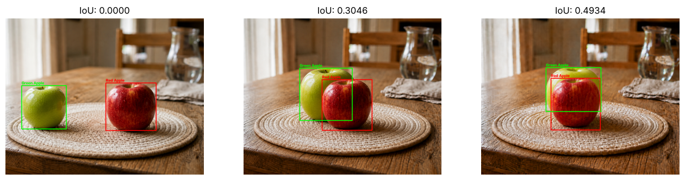
  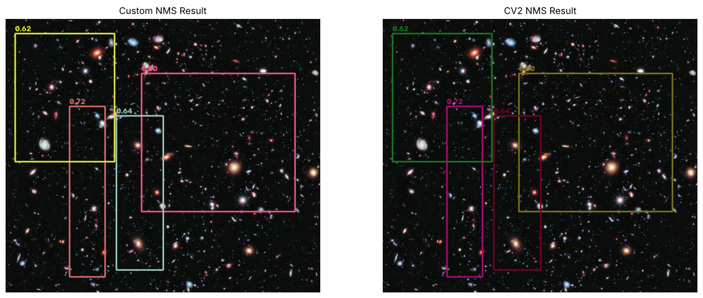
</p>

## 1. 추가된 파일

```text
261025/
├── 261025_task.py             
├── 261025_gpu_training.py     # MNIST main_gpu(), CIFAR-10 GPU 학습 및 모델 저장
├── 261025_iou_nms.py          # IoU, Confidence Thresholding, NMS 구현
├── pictures/
│   ├── IoU.png                # IoU 결과
│   ├── NMS_before.png         # NMS 적용 전 BBox
│   └── NMS_comparison.png     # 직접 구현한 NMS와 OpenCV NMS 비교
└── src/
    ├── images/
    │   └── two_apples1~3.png  # IoU 계산용 사과 이미지 3장
    └── models/
        ├── MNIST/
        │   └── MNIST_CNN.pth    # 261025_task.py에서 학습한 MNIST 모델
        └── CIFAR10/
            └── CIFAR10_CNN.pth  # 261025_gpu_training.py에서 학습한 CIFAR-10 모델
```

- 각 파일에는 필요한 import, 함수, 모델 정의, 데이터 로딩과 학습 코드가 들어 있어 따로 실행할 수 있습니다.
- `MNIST_CNN.pth`에는 `SimpleCNN`의 가중치(`state_dict`)만 저장됩니다.
- `CIFAR10_CNN.pth`에는 모델 가중치, Optimizer 상태, 마지막 테스트 정확도, Epoch 수, 클래스 이름, 정규화 평균과 표준편차가 함께 저장됩니다.
- MNIST와 CIFAR-10 데이터는 최초 실행 시 `src/datasets`에 다운로드되며, 용량이 커서 제출에는 포함하지 않았습니다.

## 2. 동작 과정 및 결과

### MNIST 모델 저장 및 불러오기 (위 과제 보완)

- `261025_task.py`에서 학습을 마친 `SimpleCNN`의 가중치를 `torch.save(model.state_dict(), ...)`로 `src/models/MNIST/MNIST_CNN.pth`에 저장합니다.
- 저장한 파일을 `torch.load(..., weights_only=True)`로 다시 불러와 새 `SimpleCNN`에 넣고, 모델 구조가 출력되는지 확인합니다.

### MNIST 데이터셋 GPU 가속 학습 (`main_gpu()`)

- 기존 `main_cpu()`와 같은 데이터셋, DataLoader, `SimpleCNN`, 손실 함수, Optimizer, Epoch 수를 사용합니다.
- 장치만 `torch.device("cuda")`로 바꾸고, `model.to(device)`로 모델을 GPU로 옮깁니다. 배치 데이터는 기존 `train_one_epoch()`, `evaluate()` 안에서 `images.to(device)`, `labels.to(device)`로 GPU에 옮겨집니다.
- GPU 연산은 비동기로 실행되므로, 시간을 재기 직전마다 `torch.cuda.synchronize()`를 호출해 GPU 작업이 끝난 시점까지 측정합니다.
- 함수 마지막에 전체 학습 시간을 반환하고, CPU 학습 시간과 나누어 가속 배율을 출력합니다.

| 실행 환경 | CPU 학습 시간 | GPU 학습 시간 | 가속 배율 |
|---|---|---|---|
| Google Colab (T4 GPU) | 56.29초 | 30.45초 | 1.85배 |
| 실습실 Jetson Orin Nano (실습 노트북) | 514.61초 | 88.59초 | 5.81배 |

- 두 환경 모두 3 Epoch 학습했고, 같은 시드를 사용해 CPU와 GPU의 정확도는 거의 같았습니다. Colab에서 3 Epoch 후 Train Accuracy는 CPU 97.89%, GPU 97.93%였습니다.
- Colab은 CPU 성능이 높아 CPU 학습 시간이 짧았기 때문에, Jetson보다 가속 배율이 낮게 나왔습니다. MNIST 모델은 크기가 작아 GPU를 사용해도 이점이 크지 않을 수 있습니다.

### CIFAR-10 이미지 분류 GPU 가속 학습과 모델 저장

- 데이터 증강(`RandomCrop`, `RandomHorizontalFlip`)은 학습 데이터에만 적용하고, 정규화(`Normalize`)는 학습·테스트 데이터 모두에 적용합니다.
- `ConvBlock` 3개, Global Average Pooling, Dropout, Linear로 구성된 `CIFAR10CNN`을 GPU로 옮기고, 측정 전에 GPU Warm-up을 실행합니다.
- 기존 `train_one_epoch()`, `evaluate()`를 사용해 5 Epoch 동안 학습과 평가를 반복하고, 각 Epoch 및 전체 학습 시간을 출력합니다.
- 학습이 끝나면 Loss, Accuracy 그래프를 출력하고, 모델을 `src/models/CIFAR10/CIFAR10_CNN.pth`에 저장합니다.
- 저장한 파일을 다시 불러와 테스트 이미지 40장을 분류합니다. 틀린 예측은 제목을 빨간색으로 표시합니다.
- 학습 설정: 5 Epoch, 학습 Batch 32, 테스트 Batch 128, `AdamW`(learning rate 0.001), `CrossEntropyLoss`, Dropout 0.3, 시드 42, 학습 파라미터 1,148,874개

<p align="center">
  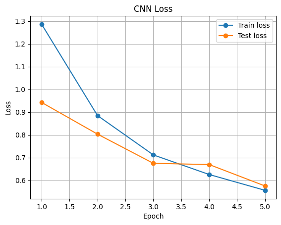
  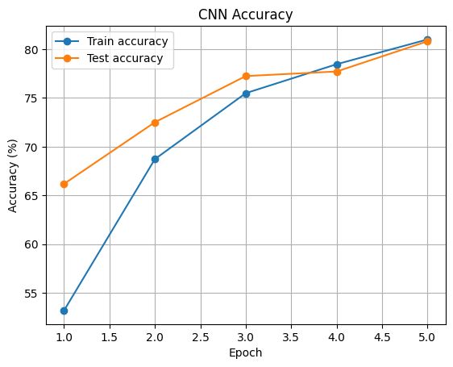
  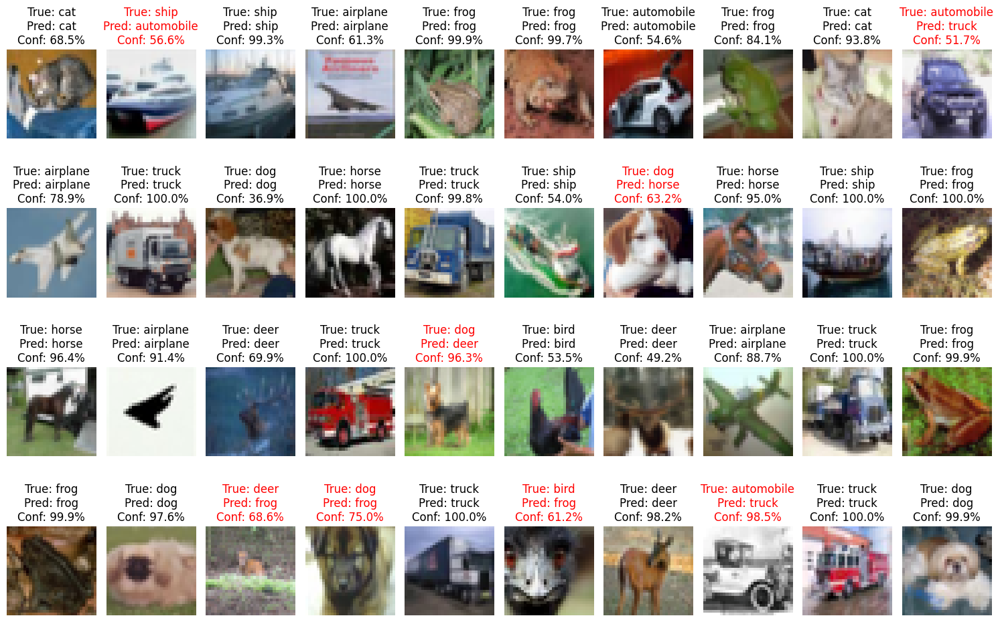
</p>

- Google Colab(T4 GPU)에서 5 Epoch 학습한 모델을 저장했으며, 저장된 마지막 테스트 정확도는 80.82%입니다.
- 5 Epoch는 CIFAR-10을 충분히 학습하기에 짧아서, 분류 결과에서 일부 이미지는 잘못 분류됩니다.

### IoU 계산

- `cv2.boundingRect()`가 반환하는 `(x, y, w, h)`를 `convert_bbox_coord()`로 `(x1, y1, x2, y2)`로 바꿉니다. 우측 하단 좌표는 `(x + w, y + h)`입니다.
- `calculate_iou()`에서는 두 BBox 좌표의 `max`, `min`으로 교집합 박스를 구하고, 겹치지 않으면 너비와 높이가 0이 되도록 `max(0, ...)`를 적용합니다.
- 합집합 넓이는 두 BBox 넓이의 합에서 교집합 넓이를 한 번 빼서 구합니다.
- 합집합 넓이가 0이면 0으로 나누지 않고 0을 반환해 `ZeroDivisionError`를 막았습니다.

<p align="center">
  
</p>

- 첫 번째 사진은 두 사과의 BBox가 겹치지 않아 IoU가 0.0000으로 나왔습니다.
- 두 번째 사진은 IoU 0.3046, 세 번째 사진은 IoU 0.4934로, 두 사과가 많이 겹칠수록 IoU가 커지는 것을 확인했습니다.
- 두 값은 실습 파일에 안내된 값(0.3046, 0.4934)과 일치합니다.

### Confidence Thresholding과 NMS

- `prune_low_conf()`는 Confidence Score가 임계값(0.5) 이상인 BBox만 남깁니다.
- `apply_nms()`는 `np.argsort()`로 Confidence가 높은 순서의 인덱스를 구한 뒤, 가장 높은 BBox를 선택하고 남은 BBox와의 IoU를 계산합니다.
- IoU가 임계값보다 큰 BBox는 같은 객체를 중복으로 잡은 것으로 보고 제거하며, 남은 BBox가 없을 때까지 선택과 제거를 반복합니다.
- IoU 계산에는 앞에서 구현한 `calculate_iou()`를 그대로 사용했습니다.
- Confidence Thresholding 결과에 NMS(IoU 임계값 0.2)를 적용하고, OpenCV `cv2.dnn.NMSBoxes()`를 사용한 `apply_nms_cv2()`와 결과를 비교합니다.

<p align="center">
  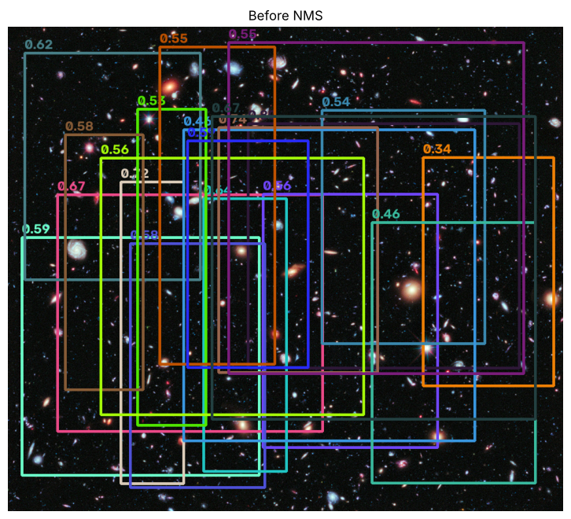
  
</p>

- 랜덤으로 만든 BBox 20개 중 Confidence 0.5 미만인 3개가 먼저 제거되어 17개가 남았습니다.
- NMS를 적용하자 겹치는 BBox가 정리되어 Confidence 0.80, 0.72, 0.64, 0.62인 BBox 4개만 남았습니다.
- 직접 구현한 NMS와 OpenCV NMS가 남긴 BBox가 같은지 비교한 결과 `True`가 출력되어, 두 결과가 일치하는 것을 확인했습니다.
- 남은 BBox끼리도 일부 겹쳐 보이지만, 교집합에 비해 합집합이 넓어 IoU가 임계값 0.2 이하인 경우입니다.

## 3. 실행 방법

각 파일이 있는 261025 폴더 안에서 실행합니다.

```bash
python 261025_task.py          # 모델 성능 확인 ~ CuPy convolution, MNIST 모델 저장
python 261025_gpu_training.py  # MNIST CPU/GPU 비교, CIFAR-10 학습 및 모델 저장
python 261025_iou_nms.py       # IoU, NMS
```

- 추가로 필요한 라이브러리: scikit-image (`261025_iou_nms.py`의 NMS 실습 이미지)
- `261025_iou_nms.py`는 GPU 없이도 실행할 수 있습니다.
- `261025_gpu_training.py`는 CUDA GPU가 필요하며, MNIST CPU 학습과 GPU 학습, CIFAR-10 학습을 차례로 진행하므로 시간이 오래 걸립니다.
- CIFAR-10(약 163MB)은 최초 실행 시 다운로드하므로 인터넷 연결이 필요하고, 다운로드 시간이 길 수 있습니다.
- 그래프 창이 표시되면 확인 후 닫아야 다음 코드가 실행됩니다.

### 제출한 모델 불러오기

학습하지 않고 제출한 `.pth` 파일만 불러와 확인할 수 있습니다. 모델 클래스(`SimpleCNN`, `ConvBlock`, `CIFAR10CNN`)는 실습 파일과 같은 정의를 사용합니다. CIFAR-10 모델은 GPU에서 저장했으므로, GPU가 없는 환경에서는 `map_location="cpu"`로 불러옵니다.

```python
import torch

# MNIST: 가중치(state_dict)만 저장
mnist_model = SimpleCNN()
mnist_model.load_state_dict(
    torch.load("src/models/MNIST/MNIST_CNN.pth", map_location="cpu", weights_only=True)
)

# CIFAR-10: 가중치와 학습 정보를 딕셔너리로 저장
checkpoint = torch.load("src/models/CIFAR10/CIFAR10_CNN.pth", map_location="cpu", weights_only=True)
cifar_model = CIFAR10CNN()
cifar_model.load_state_dict(checkpoint["model_state_dict"])
print(checkpoint["epochs"], checkpoint["test_accuracy"])
```

## 4. 아이디어와 구현 내용

### GPU 가속 방식 정리 (잔상 효과, Convolution)

- CPU(NumPy) 구현은 출력 픽셀을 Python 반복문으로 하나씩 계산합니다. 잔상 효과는 출력 픽셀마다 이동 거리 32개를 반복하고, convolution은 출력 픽셀마다 3×3 영역을 잘라 `np.sum()`으로 가중합을 구합니다. 1280×720 이미지 기준으로 출력 픽셀 약 92만 개를 하나씩 처리합니다.
- GPU(CuPy) 구현은 반복 대상을 바꿨습니다. 잔상 효과는 이동 거리(32번)만, convolution은 커널 원소(3×3 = 9번)만 Python에서 반복합니다.
- 반복할 때마다 이미지 전체를 슬라이싱한 배열에 가중치를 곱해 출력 배열에 더합니다. 이 배열 연산은 GPU에서 수많은 픽셀을 동시에 처리하므로, 픽셀 단위 반복이 사라진 만큼 빨라집니다.
- 정확한 시간 측정을 위해 GPU 연산 전에 작은 배열로 워밍업을 하고, 측정 전후에 `cp.cuda.Stream.null.synchronize()`로 GPU 연산이 끝날 때까지 기다렸습니다.
- 계산 시간만 비교한 가속 배율과, CPU↔GPU 데이터 복사 시간을 포함한 가속 배율을 따로 구해 데이터 이동 비용도 확인했습니다.

### 추가 과제 구현 내용

- `main_gpu()`는 `main_cpu()`를 그대로 가져온 뒤 장치 지정과 `torch.cuda.synchronize()`만 추가해, CPU와 GPU의 차이가 장치에서만 나도록 했습니다.
- CIFAR-10 학습 루프는 MNIST 학습 코드와 같은 구조로 작성하고, 시간 측정 전후에 `torch.cuda.synchronize()`를 넣었습니다.
- IoU 함수는 실습 설명에 나온 교집합 좌표와 너비·높이 계산식을 그대로 사용하고, 합집합 계산과 0 나누기 처리를 추가했습니다.
- `prune_low_conf()`는 반복문과 조건문으로 임계값 이상인 BBox와 점수를 함께 골라냅니다.
- `apply_nms()`는 실습 TODO의 안내대로 `np.argsort()`로 정렬 인덱스를 구하고, 앞에서 만든 `calculate_iou()`를 재사용했습니다.
- 실습 파일의 NMS 적용 코드는 Thresholding 결과를 받은 뒤 다시 원래 `boxes`에 NMS를 적용하고 있어서, Thresholding 결과(`new_boxes`, `new_scores`)에 NMS를 적용하도록 바꿨습니다. 이렇게 해야 Thresholding과 NMS를 함께 수행하는 OpenCV 결과와 같은 조건으로 비교할 수 있습니다.
- 실습 파일의 결과 그림은 NMS 후 BBox에 원래 `scores` 리스트의 점수를 표시하고 있어서, 남은 BBox의 점수(`new_scores`, `cv2_new_scores`)를 표시하도록 바꿨습니다.
- NMS 실습의 BBox는 매번 랜덤으로 만들어지므로, `random.seed(42)`로 난수를 고정해 같은 결과를 다시 확인할 수 있도록 했습니다.

## 5. 한계와 참고 사항

- `main_gpu()`와 CIFAR-10 학습은 CUDA GPU가 있어야 실행됩니다. CUDA를 사용할 수 없으면 CIFAR-10 부분에서 `RuntimeError`가 발생합니다.
- 학습 시간과 가속 배율은 실행 환경에 따라 크게 달라집니다. 위 표처럼 같은 코드라도 Colab과 Jetson의 결과가 달랐습니다.
- CIFAR-10은 5 Epoch만 학습하므로 충분히 수렴하지 않았습니다.
- `.pth`에는 Optimizer 상태도 함께 저장되어, 모델 가중치만 저장할 때보다 파일이 커집니다.
- NMS에서 Confidence Score가 완전히 같은 BBox가 있으면, 직접 구현한 정렬과 OpenCV의 정렬 순서가 달라 남는 BBox가 다를 수 있습니다. 실습처럼 점수를 실수 난수로 만들 때는 같은 점수가 나올 가능성이 매우 낮습니다.
- IoU는 픽셀 좌표의 차이(`x2 - x1`)로 너비를 계산하며, 경계 픽셀을 1칸 더 세는 방식(`x2 - x1 + 1`)은 사용하지 않았습니다.
- 과제 수행은 Google Colab에서 진행하였습니다. 런타임 유형을 T4 GPU로 변경하여 CUPY 같은 GPU 연산 기능들도 사용할 수 있도록 테스트해보았습니다.
