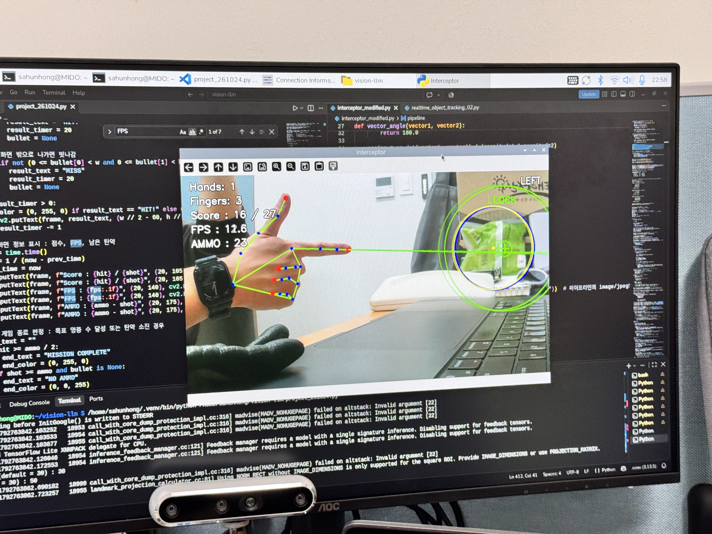
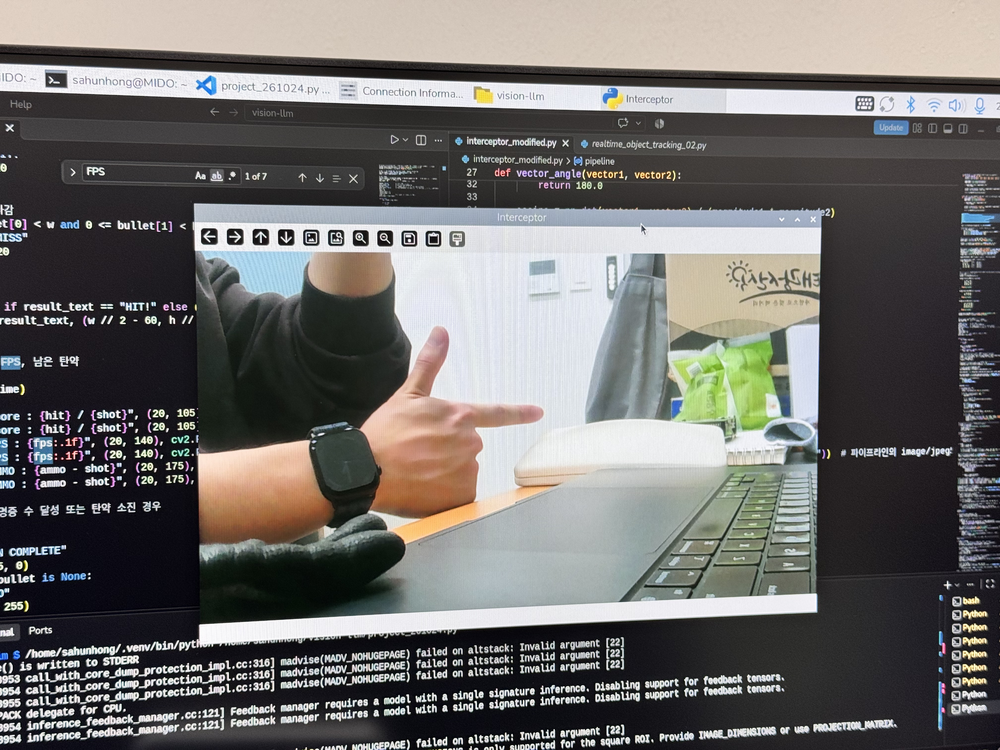
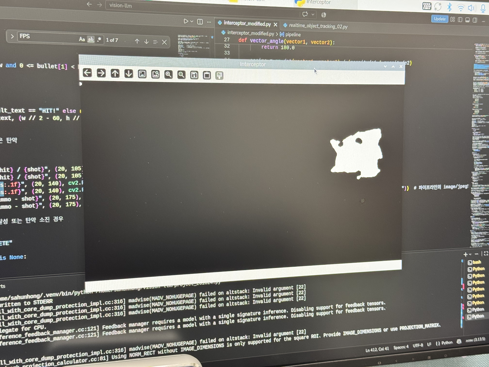

# Project01 - 움직이는 공을 손가락 총으로 맞히는 게임

`02_Computer-Vision.ipynb` - Section Project

초록색 공을 표적으로 검출하고 Kalman Filter로 추적하면서, 손가락 총 모양으로 조준해, 공이 이동할 위치를 미리 맞히는 사격 시스템을 구현하였습니다. 검지로 조준하고 엄지를 접으면 발사되며, 탄이 날아가는 동안 공도 움직이기 때문에 현재 위치가 아니라 예측 위치를 겨눠야 명중합니다. 변수값을 설정할 수 있어, 게임처럼 진행이 가능합니다.



### 실행 영상

https://github.com/user-attachments/assets/a36a6fed-101d-42e1-a89c-613396afaa2b

<br>

## 1. 파일 구조

```
Vision-LLM-202138150/
├── src/
│   └── models/
│       └── MediaPipe/
│           └── hand_landmarker.task      # 손 인식 모델
└── Project01/
    ├── project01_261024.py       # 프로젝트 코드
    ├── hand_landmarker.task      # 손 인식 모델 (MediaPipe)
    ├── original.jpg              # 실행 화면 - 원본
    ├── mask.jpg                  # 실행 화면 - 마스크
    ├── frame.jpg                 # 실행 화면 - 결과
    ├── testing.mov               # 테스트 영상
    └── README.md                 # 이 문서
```

- **project01_261024.py**: 공 검출 → 칼만 추적 → 손 인식 → 선행 조준 → 발사·명중 판정 → 화면 표시를 한 루프에서 처리하는 단일 실행 파일

<br>

## 2. 실행 방식

### 실행 환경
- Jetson (JetPack), Python 3.10, OpenCV 4.8.0 (JetPack 기본 OpenCV, GStreamer 지원)
- USB 카메라 (`/dev/video0`)

### 필요한 라이브러리 및 모델
수업에서 세팅한 Jetson 환경 그대로 사용
- OpenCV, NumPy: JetPack 기본 포함 (`--system-site-packages` 가상환경)
- MediaPipe와 `hand_landmarker.task` 모델: `02_Computer-Vision.ipynb` M 섹션에서 설치한 것을 그대로 사용
- 손 인식 모델(`hand_landmarker.task`) : Project01 폴더에 포함.

### 실행
레포 최상위 폴더에서 가상환경을 켜고 실행합니다.
```bash
cd Vision-LLM-202138150
source .venv/bin/activate
python project01_261024.py
```

실행하면 터미널에서 두 값을 입력받습니다. 엔터만 누르면 기본값 30이 들어갑니다.
```
bullet speed(default = 30, maximum = 60) :     # 탄 속도 (픽셀 / 프레임)
ammo(default = 30) :             # 탄약 수
```

### 조작 방법
| 입력 | 동작 |
|---|---|
| 검지를 편 손가락 총 모양 | 조준 (검지 방향으로 조준선 표시) |
| 조준 중 엄지 접기 | 발사 (접는 순간 한 발) |
| `1` / `2` / `3` | 원본 화면 / 공 마스크 화면 / 결과 화면 |
| `q` | 종료 |

### 화면 표시
| 표시 | 의미 |
|---|---|
| 파란 원 | 이번 프레임에 실제로 검출한 공 위치 (측정값) |
| 노란 원 | Kalman Filter가 추정한 현재 공 위치 |
| 십자 원 | 탄이 도착할 때의 공 예측 위치 (LOCK이면 초록, 아니면 하늘색), 목표의 1.5배 크기 보조 원도 포함 |
| 조준선 | 검지 끝에서 가리키는 방향 (LOCK이면 초록, 아니면 빨강) |
| 흰 점 | 날아가는 탄 |
| HIT! / MISS | 명중 / 빗나감 |
| 좌측 상단 | 손 개수, 펴진 손가락 수, 점수, FPS, 남은 탄약 |
| 우측 상단 | 오른손 / 왼손 판정 |

**게임 규칙**: 탄약의 절반 이상을 명중시키면 `MISSION COMPLETE`, 탄약을 모두 쓰면 `NO AMMO`가 표시되고 아무 키나 누르면 종료됩니다.

<br>

## 3. 동작 과정

**흐름 정리 : 프레임 읽기 → 이미지 조정 → 공 검출 → 칼만 추적 → 손 검출 → 선행 조준(LOCK) → 발사·명중 판정 → 화면 표시 → 반복**

### 1단계. 루프 전 준비 (1~133줄) - 프로그램이 시작할 때 딱 한 번 실행되는 부분

1. 라이브러리 불러오기 (1~6줄) : FPS 계산, OpenCV, numpy, mediapipe 등을 꺼내오기

2. 각도 함수 두 개 (8~35줄) :
   - calculate_angle - 손가락 관절이 얼마나 펴졌는지 확인. 손가락을 쭉 펴면 180도, 구부릴수록 각도가 작아진다.
   - vector_angle - 손가락이 가리키는 방향과 공이 있을 방향을 비교. 계산이 불가하면 정반대 방향인 180도를 돌려줌.

3. 카메라 열기(pipeline) (37~47줄) : 영상이 카메라에서 OpenCV까지 오는 과정을 글로 적은 것

4. 공 검출 설정 (49~54줄) : LAB 색공간에서 초록공으로 인정할 범위를 정하고, kernel과 clahe를 정의

5. 손 검출 설정 (56~72줄) : 손 인식 모델을 불러오고, 손가락을 판단할 기준을 정함.

6. 칼만 필터 설정 (74~112줄) : 공의 위치와 속도를 추정할 칼만 필터를 만들고, 계산 규칙을 정함.
   - 칼만 필터는 이 두 노이즈를 비교해서 예측을 더 믿을지, 측정을 더 믿을지를 정한다. 측정 노이즈가 크면 예측을 더 믿어서 움직임이 부드럽지만 반응이 늦고, 예측 노이즈가 크면 측정을 더 믿어서 반응은 빠르지만 흔들린다.

7. 실행 시 입력 받기 (114~122줄) : 프로그램을 켤 때 탄 속도와 탄약 수를 물어봄. 빈 문자열이면 기본값인 30을 넣음.

8. 프레임 사이에 기억할 변수 (124~133줄) : 프레임이 넘어가도 값이 유지돼야 하는 변수를 만듦.


### 2단계. 한 프레임 처리 (135~413줄) - while True 안에서 한 프레임 반복.

9. 프레임 읽기와 키 입력 (135~146줄) : 카메라에서 사진 한 장을 받고, 키보드 입력을 확인.
    - `ret, frame = cap.read()` : 카메라에서 사진 한 장을 받음. ret은 성공 여부(True/False), frame은 사진
    - `if key == ord("q")` : q를 누르면 반복을 끝냄.
    - `view = key - ord("0")` : 1, 2, 3 키를 숫자로 바꿔서 화면 종류를 저장.

10. 이미지 조정 (148~152줄) : 사진 크기를 줄이고, 뒤집고, 원본을 복사
    - 가로를 960으로 줄이고, 세로는 비율에 맞춰 계산. 픽셀 수를 줄여서 처리 속도 향상
    - `cv2.flip(frame, 1)`으로 좌우를 뒤집어 거울처럼 보이게 만듦.
    - `original = frame.copy()`으로 아무것도 그리기 전 원본을 따로 복사하여 1번 키로 보일 수 있도록 함.

11. 공 찾기 준비, 전처리와 마스크 (154~167줄) : 사진에서 초록색 부분만 하얗게 남긴 흑백 그림인 마스크를 만듦.
    - 가우시안블러를 통해 자잘한 픽셀 노이즈를 뭉갠다.
    - 색공간을 LAB로 바꾸고, 채널을 나누어 CLAHE를 통해 밝기를 보정하고, 다시 합침.
    - `cv2.inRange`를 통해 색을 골라낸다.
    - Opening을 2번 반복하여 자잘한 노이즈를 최대한 지움.
    - Closing을 3번 반복하여 공 안의 작은 검은 구멍을 메워서 꽉 찬 덩어리로 만듦.

12. 윤곽선 찾기 (170~175줄) : 마스크의 흰 덩어리들의 테두리를 찾아서 목록으로 만듦.

13. 공 고르기와 칼만 시작 (177~205줄) : 테두리 중 공을 고르고, 크기와 중심을 구해서 파란 원을 그림. 이후 처음 찾았으면 칼만 필터를 시작한다.

14. 칼만 필터로 추적 (207~223줄) : 공이 보이면 예측하고 보정. 안 보이면 예측만 진행.
    - 경우 1. 추적 중이고 공이 보일 때 : state = kalman.correct(z)으로 실제 측정값을 보고 예측을 보정. 결과가 state에 담긴다.
    - 경우 2. 추적 중인데 공이 안 보일 때 : state = kalman.predict()로 예측만 해서 직전 속도로 계속 움직인다고 가정. 30프레임(약 3~6초) 넘게 안 보이면 추적을 포기

15. 추정 위치에 노란 원 (225~232줄) : 칼만이 추정한 공 위치를 꺼내서 노란 원으로 그린다.

16. 손 검출 (234~239줄) : 원본 사진에서 손을 찾고, 왼손과 오른손을 구한다.
    - MediaPipe는 RGB 순서를 사용하므로 바꾸어준다.
    - 리스트 컴프리헨션을 통해 왼손과 오른손을 구분

17. 펴진 손가락 세기 (241~251줄) : 화면에 보이는 모든 손에서 펴진 손가락이 총 몇 개인지 계산.

18. 화면에 손 정보 쓰기와 뼈대 그리기 (253~276줄) : 손 개수, 손가락 개수, 왼손/오른손을 화면 위에 글자로 띄운다. 이후 손가락 뼈대를 그린다.

19. 조준과 발사 자세 판단 (278~302줄) : 첫 번째 손의 손가락 상태를 보고, 조준 중인지 아니면 발사 자세인지 결정.
    - `aiming = False, fire = False` : 매 프레임마다 조준을 안하고, 발사를 안 한다라고 먼저 정해둔다.
    - `finger_up = []` : 손가락 다섯 개의 펴짐 여부를 True/False로 리스트에 차례로 넣는다(append 사용). 손가락 총 모양에 엄지를 접은 상태라면, 리스트는 [False, True, False, False, False] 형태가 된다.
    - `aim_start` : 조준선이 시작하는 곳으로, 검지 끝(8번)을 의미.
    - `aim_dir` : 검지 끝(8번) − 검지 뿌리(5번)으로, 손가락이 가리키는 방향.
    - `if finger_up[1] and ...` : 검지가 펴져 있을 때만 조준으로 본다.
    - `aim_dir = aim_dir / np.linalg.norm(aim_dir)` : 방향 화살표를 자기 길이로 나누어서 길이를 1로 만든다.
    - `fire = not finger_up[0]` : 엄지가 펴져 있지 않으면 발사 자세로 본다.

20. 선행 조준: 미래 위치 예측과 LOCK (304~331줄) : 탄이 도착할 때 공이 어디 있을지 예측하고, 손가락이 그곳을 가리키는지 판단.
    - `k = distance / bullet_speed` : 탄이 공까지 가는 데 몇 프레임 걸리는지. 만약 거리 101, 속도 30이면 3.37이고, int로 소수점을 버려서 3이 된다. 즉, 공까지 가는데 3프레임이 소요된다. np.clip(값, 1, 30)은 1보다 작으면 1, 30보다 크면 30으로 자르는 역할이다.
    - x_fut, y_fut : 결과 표에서 0행(x)과 1행(y)을 꺼내, 탄이 도착할 때 공이 있을 곳을 정의.
    - lock_angle : 그 거리에서 공이 차지하는 각도
    - lock = aim_error < lock_angle : 조준 오차가 그 각도보다 작으면 조준선이 공을 지나간다는 뜻 = LOCK

21. 조준선 그리기 (333~337줄) : 검지 끝에서 가리키는 방향으로 일직선을 그음.

22. 발사 (339~344줄) : 엄지를 접는 순간에 탄을 하나 만듦.

23. 탄 이동과 명중 판정 (346~364줄) : 탄을 움직이고, 공에 맞았는지, 아니면 화면 밖으로 나갔는지 판정.
    - `bullet = None` : 탄을 없애야 다음 발사가 가능.

24. HIT/MISS 글자 표시 (366~369줄) : 판정 결과를 20프레임 동안 화면 가운데에 보여준다.

25. 점수, FPS, 탄약 표시 (371~380줄) : 화면 왼쪽 위에 게임 정보를 표시함.

26. 게임 종료 판정 (382~406줄) : 목표를 달성하거나, 탄약을 다 쓰면 종료 화면을 보여주고 멈춘다.
    - `hit >= ammo / 2` : 탄약의 절반 이상 명중하면 성공
    - `shot >= ammo and bullet is None` : 탄약을 다 썼고, 마지막 탄의 판정까지 끝났으면 실패

27. 화면 출력 (408~413줄) : 선택한 화면 종류에 따라 창에 화면을 띄운다.
    - **1** : 그림이 없는 원본
    - **2** : 흑백 마스크
    - **그 외** : 모든 그림이 그려진 결과 화면. 키 입력을 1~3만 받기 때문에 실제로는 3일 때이고, else로 두어 예상하지 못한 값이 들어와도 결과 화면이 뜨도록 함
    - 세 경우 모두 창 이름이 같아서 새 창이 생기지 않고 같은 창의 내용만 바뀜
   
<p align="center">
  
  
  
</p>
   
### 3단계. 종료 및 정리 (415~417줄) : 반복이 끝난 뒤 한 번만 실행. q를 누르거나 게임이 끝났을 때 실행.

- `hand_detector.close()` : MediaPipe 모델이 쓰던 메모리를 해제.
- `cap.release()` : 다른 프로그램이 카메라를 쓸 수 있게 함.
- `cv2.destroyAllWindows()` : 열린 창을 모두 닫음.

<br>

## 4. 창의성 및 확장성

### 아이디어 설명
과제 조건인 객체를 인식 및 추적하고 신체와의 관계성을 표현하는 것을, 저는 손가락이 공을 겨누고 있는가로 정의했습니다. 움직이는 표적을 맞히려면 표적의 현재 위치가 아니라 탄이 도착할 때의 위치를 겨눠야 한다는 선행 조준 개념을 적용했습니다.

기존 실습 코드 세 개(`realtime_object_detection.py`, `realtime_object_tracking_02.py`, `finger_tip.py`)의 결과가 모두 같은 픽셀 좌표계라는 점을 이용해, 공의 위치와 손가락 방향을 직접 비교하도록 연결했습니다.

### 구현한 내용

**요구 기술 적용**

| 요구 기술 | 적용 내용 | `project01_261024.py` 줄 |
|---|---|---|
| 이미지 조정 | `cv2.resize` (가로 960 축소), `cv2.flip` (좌우 반전) | 149-150 |
| 색공간 변환 | BGR → LAB (공 검출), BGR → RGB (MediaPipe 입력) | 156, 235 |
| Image Enhancement | L(밝기) 채널에 CLAHE | 158-160 |
| 필터링 | `cv2.GaussianBlur` (7×7) | 155 |
| Color Segmentation | `cv2.inRange` (LAB 범위로 초록 공 마스크) | 163 |
| Morphology | Opening 2회, Closing 3회 | 165-166 |
| Contour Detection | `findContours`, 가장 큰 윤곽 선택, `minEnclosingCircle`, `moments` 무게중심 | 171-194 |
| 객체 추적 | Kalman Filter predict / correct, 가려짐 대응, k프레임 앞 예측 | 201-232, 313-317 |
| 신체 인식 | MediaPipe 손 랜드마크, 손가락 각도, 검지 방향 | 235-302 |
| 관계성 표현 | 조준 방향과 예측 위치 사이 각도로 LOCK 판정, 조준선·십자·HIT/MISS·점수·탄약 오버레이 | 304-406 |

**1) 선행 조준 (Kalman Filter로 미래 위치 예측)**

기존 실습에서는 Kalman Filter를 공이 가려졌을 때 위치를 이어가는 데만 사용했지만, 상태에 속도가 포함되어 있으므로 상태 전이 행렬 F를 여러 번 곱하면 미래 위치도 구할 수 있습니다.
```
k = 거리(검지 끝 ~ 공) / 탄 속도   (1 ~ 30 프레임으로 제한)
미래 상태 = F^k × 현재 상태  →  (x + k·vx, y + k·vy)
```

**2) 조준 판정 (각도 비교)**

`finger_tip.py`의 `calculate_angle`과 같은 원리(내적)로 두 벡터 사이 각도를 구하는 `vector_angle` 함수를 만들었습니다.
- 조준 방향: 검지 뿌리(5번) → 검지 끝(8번)
- 표적 방향: 검지 끝 → 공 예측 위치
- 두 방향 사이 각도가 그 거리에서 공이 차지하는 각도인 `arctan(반지름 × 1.5 / 거리)`보다 작으면 LOCK

멀리 있는 공일수록 허용 각도가 작아져서 더 정확하게 겨눠야 합니다.

**3) 손가락 총 제스처**

`finger_tip.py`의 손가락 개수 세기를 손가락별 True/False 리스트로 바꿔, 손가락마다 다른 역할을 주었습니다.
- 검지가 펴져 있으면 조준
- 조준 중 엄지가 접히면 발사 자세
- 직전 프레임 상태(`prev_fire`)와 비교해서 **엄지를 접는 순간에만** 한 발 발사 (접고 있는 동안 연속 발사 방지)

**4) 명중 판정과 게임 규칙**
- 탄은 매 프레임 조준 방향으로 `bullet_speed`만큼 이동하고, 그 프레임의 공 위치(노란 원)와의 거리가 반지름보다 작으면 HIT
- 예측 위치가 아니라 그 프레임의 공 위치로 판정하므로, 선행 조준을 해야 명중
- 탄 속도와 탄약 수를 실행 시 입력받고, 탄약의 절반 이상 명중 시 MISSION COMPLETE, 탄약 소진 시 NO AMMO
- 마지막 탄의 판정이 끝난 뒤 종료되도록 `bullet is None` 조건을 함께 확인

**5) 기존 실습 코드에서 바꾼 부분**

| 내용 | 이유 |
|---|---|
| Kalman 최초 검출 시 `statePost`도 초기화 | `predict()`는 `statePost`를 기준으로 계산하므로, `statePre`만 설정하면 첫 예측이 (0, 0)으로 끌려감 |
| 30프레임 이상 안 보이면 추적 종료 | 공이 사라진 뒤 예측만 무한히 이어지는 것 방지 |
| 면적 100 이하 contour 무시 | 작은 노이즈를 공으로 오인하는 것 방지 |
| Opening 후 Closing 추가 | 공 안쪽 반사광으로 생긴 구멍 메우기 |
| `flip(frame, 0)` → `flip(frame, 1)` | 상하 반전이 아니라 거울처럼 좌우 반전되도록 만들어서 손 움직임과 화면 방향이 일치 |
| 1~3 키로 화면 전환 | 원본 / 마스크 / 결과를 바꿔 보며 중간 과정을 확인 |

**6) 추가로 수정한 부분**
- **탄 속도, 탄약 입력 추가 (115~121줄)**
  - 코드를 고치지 않고 실행할 때마다 게임 규칙을 바꿀 수 있도록, `input()`으로 탄 속도와 탄약 수를 입력받습니다.
  - `input()`은 항상 문자열을 돌려주므로 `int()`로 바꾸고, 엔터만 눌러서 빈 문자열이 들어오면 기본값 30을 넣습니다.
  - 탄 속도는 픽셀/프레임 단위라서, 같은 값이라도 FPS가 낮은 환경에서는 탄이 느리게 느껴집니다. 그래서 실행 환경에 맞게 직접 조절할 수 있도록 했습니다.
  - 탄 속도가 60을 넘으면 `SystemExit`으로 바로 종료합니다. 탄이 한 프레임에 공 지름보다 많이 이동하면 명중 판정을 건너뛰는 문제가 있어서, 테스트로 정상 판정되는 것을 확인한 60을 상한으로 정했습니다.

- **종료 규칙을 만들어서 게임처럼 구현 (382~406줄)**
  - 단순히 맞히고 끝나는 것이 아니라 목표와 제한이 있도록, 성공과 실패 두 가지 종료 조건을 만들어서 게임의 형태로 구현해보았습니다.
    - 성공 : `hit >= ammo / 2` → 탄약의 절반 이상 명중하면 초록색 `MISSION COMPLETE`
    - 실패 : `shot >= ammo and bullet is None` → 탄약을 다 쓰고 마지막 탄의 판정까지 끝나면 빨간색 `NO AMMO`
  - 성공 조건을 먼저 확인하기 때문에, 마지막 탄으로 절반을 채운 경우에도 성공으로 처리됩니다.
  - 종료되면 화면 가운데에 결과 메시지와 최종 점수(`명중 / 발사`)를 띄우고, 터미널에도 결과를 출력합니다. 이후 `cv2.waitKey(0)`으로 아무 키를 누를 때까지 화면을 멈춘 뒤 반복을 빠져나와 정리 단계로 넘어갑니다.
  - 게임 진행 상황을 알 수 있도록 좌측 상단에 점수(`Score : 명중 / 발사`)와 남은 탄약(`AMMO : 탄약 - 발사 수`)을 매 프레임 표시합니다. (375~380줄)

- **가독성을 위해 글자에 검은색 외곽선 추가 (254~257, 263~264, 375~380, 396~401줄)**
  - 카메라 화면은 배경이 계속 바뀌기 때문에, 흰 글자만 쓰면 밝은 배경 위에서 글자가 잘 보이지 않습니다.
  - 같은 글자를 같은 위치에 두 번 그리는 방식으로 해결했습니다. 먼저 검은색으로 두껍게(두께 5, 종료 메시지는 8) 글자를 쓰고, 그 위에 흰색이나 결과 색으로 얇게(두께 2, 종료 메시지는 4) 글자를 써서 테두리를 만들었습니다.
  - 별도의 함수나 라이브러리 없이 `cv2.putText`만 두 번 호출하면 되기 때문에, 화면에 지속적으로 표시되는 정보(손 개수, 손가락 수, 좌우 손, 점수, FPS, 탄약, 종료 메시지)에 같은 방식을 적용했습니다.

- **LOCK을 쉽게 하기 위해 십자선에 목표의 1.5배의 원을 추가 (322, 326~331줄)**
  - 예측 위치에 십자선만 있으면 어디까지 겨눠야 LOCK이 되는지 알기 어렵고, 움직이는 공의 예측 위치를 정확히 가리키는 것 자체가 어렵습니다.
  - 그래서 LOCK 허용 각도인 공 반지름의 1.5배 기준(`arctan(radius × 1.5 / 거리)`)을 바탕으로 예측 위치에 같은 크기의 원을 그려서, 이 원 안을 가리키면 락온이라는 것이 눈에 보이도록 했습니다.
  - 공 크기와 상관없이 반지름 20의 원을 십자선 주변에 띄워서 사격하는 느낌이 나도록 구현해보았습니다.
  - 십자선과 원은 LOCK이면 초록색, 아니면 하늘색으로 바뀌고, LOCK일 때는 원 위에 `LOCK` 글자를 띄웁니다.
  - 단, 명중 판정은 공 반지름(1배) 기준이기 때문에 LOCK 원의 가장자리를 겨누면 LOCK이 떠도 MISS가 날 수 있습니다. 즉 1.5배 원은 조준을 도와주는 보조 표시이고, 정확히 맞히려면 원의 중심(십자)을 겨눠야 합니다.

### 한계
- **등속 운동 가정** : 공이 방향을 바꾸거나, 속도가 변하면 예측이 빗나감
- **k 계산의 근사** : 도착 프레임 수를 현재 위치까지 거리로 계산하고 소수점을 버리기 때문에, 실제 만나는 시점과 프레임 차이가 날 수 있고, 공이 탄 방향으로 움직이면 오차가 더 커짐
- **탄의 이산 이동** : 탄이 한 프레임에 `bullet_speed` 픽셀씩 이동하므로, 공이 너무 작으면 두 위치 사이로 지나쳐 판정을 놓칠 수 있음
- **색 기반 검출** : 배경에 비슷한 초록색 물체가 있거나 조명이 크게 바뀌면 검출이 힘들거나, 이상한 것을 오탐할 수 있음. 실제로 연구실 칸막이 색깔을 혼동하는 경우가 많았음
- **제스처 판정** : 엄지는 2번 관절보다 뿌리 쪽에서 많이 움직여서, 각도 기준만으로는 접힘 판정이 불안정할 수 있음
- **탄 속도 입력 오류** : 속도에서 0이나 음수를 넣으면 탄이 움직이지 않거나 뒤로 가는 문제 발생. 다음 발사도 이루어지지 않음
- **탄약 입력 오류** : 탄약에 0을 넣으면 시작하자마자 종료
- 손이 2개 검출되면 첫 번째 손만 조준에 사용하기에, 사격을 위한 손 인식이 왔다갔다하는 불안정한 모습을 보여줌

### 확장성
- **등가속 모델**: 상태에 가속도를 추가해서 방향이 바뀌는 표적을 예측하는 모델 구현 가능
- **유도탄**: 발사 후에도 매 프레임 예측 위치로 방향을 수정하는 방식(비례항법 등)으로 확장
- **딥러닝 검출**: 색 기반 검출을 YOLO 같은 객체 검출 모델로 바꿔 다양한 표적에 대응
- **요격 드론 연구와 연결**: 카메라 기반 표적 추적과 선행 예측은 실제 요격 드론의 유도에 쓰이는 개념과 같은 구조

<br>

## 5. 기타 참고 사항

### 작업 중 겪은 문제와 해결
- **라즈베리파이에서 MediaPipe 에러**
  - 문제 : 개인 라즈베리파이 + USB 카메라로 사전 테스트를 했는데, MediaPipe 실행 시 `certifi`가 없다는 에러가 났습니다.
  - 원인 : MediaPipe를 `--no-deps`로 설치했기 때문입니다. Jetson은 가상환경을 `--system-site-packages`로 만들어 시스템에 있는 패키지를 빌려 쓰기 때문에 문제가 없었지만, 라즈베리파이 가상환경에는 그 패키지가 없었습니다.
  - 해결 : 빠진 패키지를 직접 설치했습니다.

- **카메라가 열리지 않음 (GStreamer 파이프라인)**
  - 문제 : 파이프라인을 여러 줄로 나눠 쓰다가 카메라가 열리지 않았습니다.
  - 원인 : 파이썬은 괄호 안의 문자열을 공백 없이 그대로 이어 붙입니다. 줄 끝 공백과 `!`를 빠뜨려서 `format=BGRqueue`처럼 글자가 붙어버렸습니다.
  - 해결 : 줄 끝마다 공백을 넣고, 빠진 `!`를 추가했습니다.

- **마지막 탄이 판정되지 않음**
  - 문제 : 탄약을 다 쓰는 순간 바로 게임이 끝나서, 마지막 탄은 명중 여부를 판정받지 못했습니다.
  - 원인 : `shot == 30`이 되는 그 프레임에 바로 종료했기 때문입니다.
  - 해결 : 날아가는 탄이 없을 때(`bullet is None`)까지 기다렸다가 종료하도록 바꿨습니다.

- **발사 모드 입력이 동작하지 않음**
  - 문제 : 단발/연사 모드를 입력받으려고 했는데, 무엇을 입력해도 단발로만 동작했습니다.
  - 원인 : `input()`은 항상 문자열을 돌려줍니다. `"False"`를 입력해도 비어 있지 않은 문자열이라 참으로 처리됐고, 이 값을 넣은 `prev_fire`도 첫 프레임에 바로 다른 값으로 덮어써졌습니다.
  - 해결 : `prev_fire`는 원래 용도(직전 프레임의 발사 자세)로만 쓰고, 입력은 탄 속도와 탄약 수만 받도록 정리하여, 단발 모드만 구현하였습니다.

- **Jetson에서 빠른 탄이 공을 지나가도 MISS로 판정됨**
  - 문제 : 라즈베리파이 5 (8GB)에서는 FPS가 15~20이었는데, Jetson에서는 5~10으로 낮게 나왔습니다. Jetson에서 탄 속도를 높이자, 탄이 공을 지나갔는데도 MISS로 판정되는 문제가 생겼습니다.
  - 원인 : 탄 속도는 픽셀/프레임 단위라서, FPS가 낮으면 같은 값이라도 탄이 느리게 느껴져 탄 속도를 높이게 됩니다. 그런데 명중 판정은 프레임마다 탄이 있는 한 점에서만 하기 때문에, 탄이 한 프레임에 공 지름보다 많이 이동하면 공을 건너뛰어서 판정하는 순간에는 탄이 항상 공 밖에 있게 됩니다. FPS가 낮으면 프레임 사이에 공도 더 많이 움직여서 이 문제가 더 잘 생깁니다.
  - 해결 : 처리 해상도를 낮추면 FPS는 오르지만 검출 품질이 떨어지기 때문에, 대신 테스트를 통해 탄 속도를 60 이하로 사용하면 정상적으로 판정되는 것을 확인했습니다.

### AI 활용 vs. 본인 기여도
- **AI 활용**
  - 초기 코드 구조 작성과 기존 실습 코드 스타일에 맞춘 단순화
  - Kalman `statePost` 초기화 문제 지적
  - 라즈베리파이 테스트 환경 세팅 방법
  - 라즈베리파이 환경 구축, 실행, 에러 대응
  - 코드 리뷰(버그 지적)와 코드 동작 설명
- **본인 기여**
  - 요격이라는 키워드를 바탕으로 손가락 총 아이디어 구상과 전체 방향 결정
  - 기존 261018 폴더 코드 및 실습 파일 내용을 토대로 이해할 수 있는 구조로 정리
  - 손 표시 부분을 기존 `finger_tip.py` 방식으로 복원
  - 처리 해상도(960)설정, morphology 반복 횟수(Opening 2회, Closing 3회) 조정
  - 실행 시 탄 속도·탄약 입력, 게임 규칙(탄약 소진, 절반 명중 시 성공) 추가
  - 예측 위치 원, 남은 탄약, 글자 테두리 등 화면 표시 수정
  - 코드 전체 주석 작성과 동작 원리 학습
