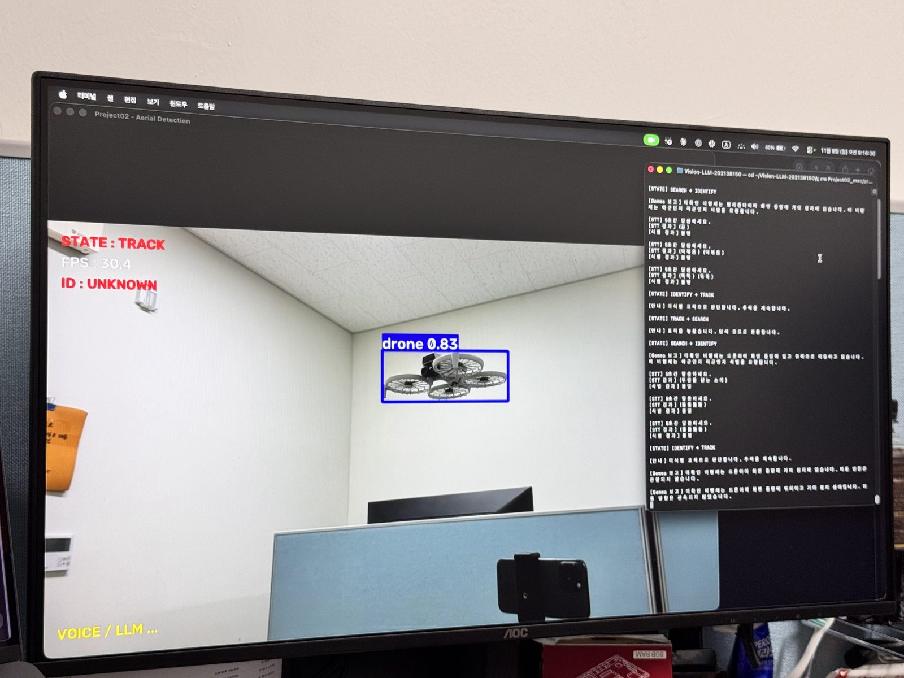
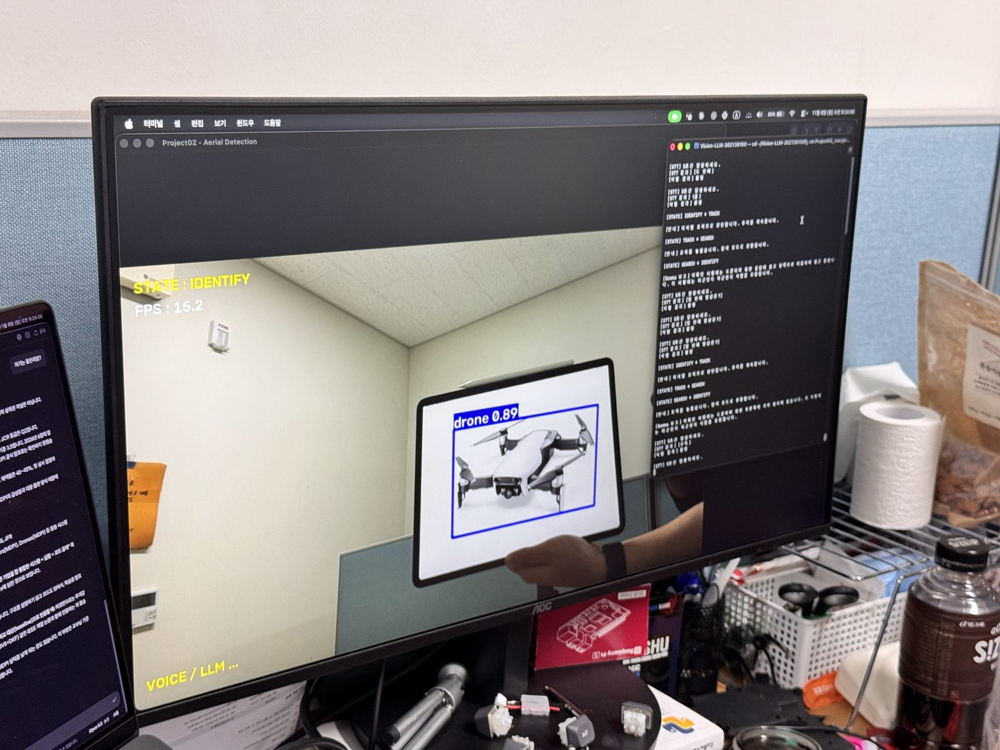
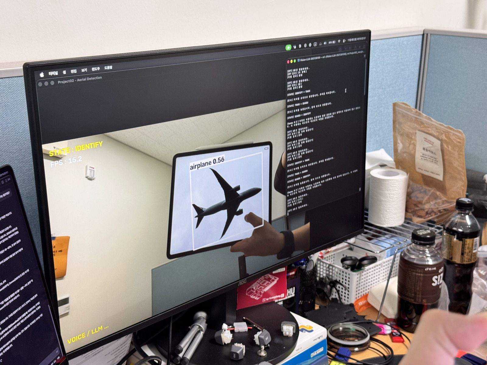
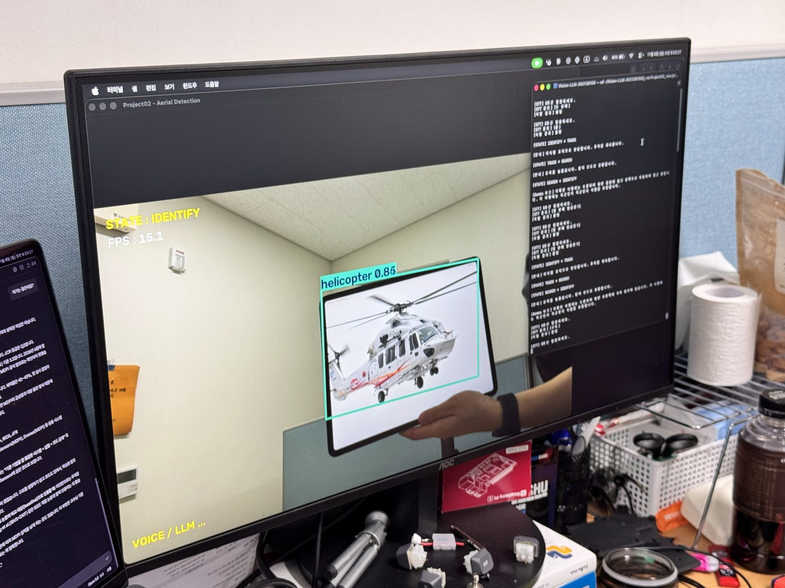
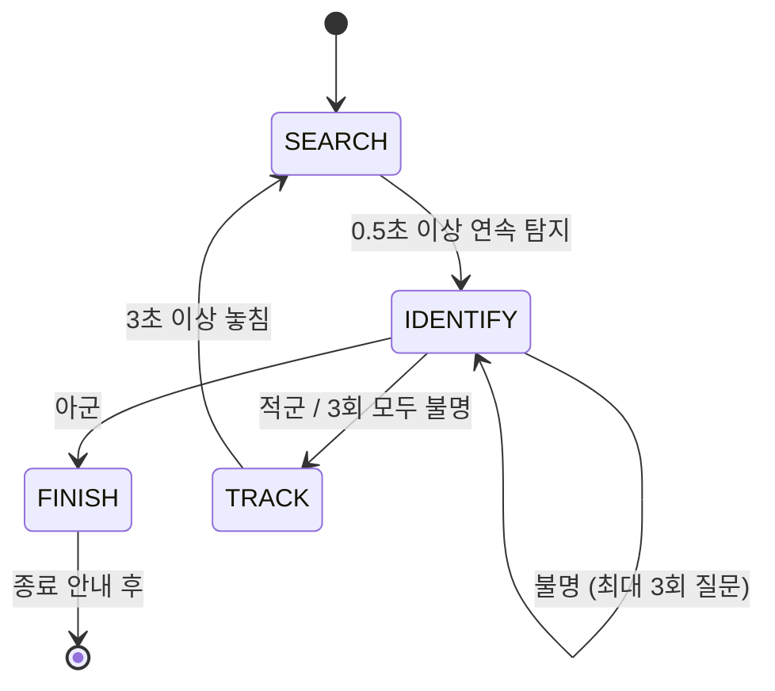

# Project02 - 비행체 탐지, 보고, 음성 피아식별 시스템

`06-Vision_LLM_Multimodal_Systems.ipynb` - Final Project

카메라에 드론, 비행기, 헬리콥터 등의 비행체가 나타나면 YOLO로 탐지하고, 표적의 종류와 화면상 위치, 이동 방향, 접근 여부를 계산해 Gemma가 음성으로 보고합니다. 사용자가 "아군" 이라고 답하면 추적을 종료하고, "적군" 이라고 답하면 표적을 계속 추적하면서 주기적으로 보고합니다. 드론 탐지 시스템의 첫 단계인 **탐지 → 보고 → 식별 → 추적** 흐름을 Vision-LLM과 음성으로 구현했습니다.

탐지 모델은 드론을 포함한 비행체 5종으로 학습된 공개 모델 **HusAero-8n**(YOLOv8n 기반)을 사용하고, 04 섹션 실습과 같은 방식으로 **TensorRT INT8 엔진**으로 변환해 Jetson에서 실행합니다.

Project01의 피드백을 반영해, 이번에는 **스테이트 머신**으로 전체 흐름을 설계했습니다.




### 구현 영상

https://github.com/user-attachments/assets/52f2f2d4-0a0e-4422-803c-735e52fb133f

<br>

https://github.com/user-attachments/assets/9f54c09c-8d9b-44d0-9724-74574c777b84

<br>

https://github.com/user-attachments/assets/5cb904dd-8dca-499b-8c07-90ff79691123

<br>

## 1. 파일 구조

```
Vision-LLM-202138150/
├── src/
│   ├── models/
│   │   ├── YOLO/husaero/
│   │   │   ├── HusAero-8n.pt                           # 탐지 모델 원본 (레포에 포함, HusAero v0.3.0-rc5)
│   │   │   └── HusAero-8n_int8.engine                  # INT8 TensorRT 엔진 (husaero_int8.py로 생성)
│   │   ├── Gemma4/google_gemma-4-E2B-it-Q4_K_M.gguf    # Gemma 4 E2B
│   │   └── Piper/ko_KR-kss-medium.onnx                 # 한국어 TTS 음성
│   ├── datasets/husaero/                               # INT8 캘리브레이션용 val 250장 (레포에 포함)
│   ├── json/vision_data.json                           # 보고 시점의 탐지 결과 (실행 중 자동 생성)
│   └── audio/                                          # 녹음(input.wav) / TTS(response.wav) (실행 중 자동 생성)
├── whisper.cpp/                                        # STT (06 C-1에서 빌드)
├── .piper_venv/                                        # TTS 전용 가상환경 (06 C-2)
└── Project02/
    ├── project02_261108.py                             # 프로젝트 코드
    ├── husaero_int8.py                                 # HusAero-8n → INT8 TensorRT 엔진 변환
    └── README.md                                       # 이 문서
```

- **project02_261108.py**: 카메라 → YOLO 탐지 → 위치·방향 계산 → 스테이트 머신 → Gemma 보고 → TTS → STT → Gemma 피아식별을 처리하는 단일 실행 파일
- **husaero_int8.py**: 04 실습 파일의 INT8 변환 코드(`quantize=8`)를 HusAero-8n에 적용한 변환 스크립트

<br>

## 2. 실행 방식

### 실행 환경
- Jetson (JetPack), Python 3.10
- USB 카메라 (`/dev/video0`, GStreamer pipeline)
- USB 마이크, 스피커

### 필요한 라이브러리 및 모델
06 노트북에서 세팅한 환경을 그대로 사용합니다.
- ultralytics, llama-cpp-python : 레포의 `.venv` 가상환경
- Gemma 모델 : `src/models/Gemma4/` (05 섹션에서 준비)
- Whisper : `whisper.cpp/build-cpu/bin/whisper-cli`, `ggml-base.bin` (06 C-1)
- Piper : `.piper_venv` + `ko_KR-kss-medium.onnx` (06 C-2)
- HusAero : `HusAero-8n.pt`와 캘리브레이션용 val 이미지 250장은 레포에 포함되어 있어 따로 받을 필요 없음
  - 원본 : [GitHub Releases](https://github.com/27kwt/HusAero/releases)의 `HusAero-v0.3.0-rc5-Complete.zip`

### 탐지 모델 준비 (처음 한 번)
레포 최상위 폴더에서 INT8 엔진으로 변환합니다.
```bash
cd ~/vision-llm          
source .venv/bin/activate
python Project02/husaero_int8.py
```
`src/models/YOLO/husaero/HusAero-8n_int8.engine`이 생기면 완료입니다. 캘리브레이션 데이터는 `CALIBRATION` 값으로 고릅니다.

| 값 | 캘리브레이션 이미지                              | 비고 |
|---|-----------------------------------------|---|
| `"husaero"` (기본) | HusAero dataset의 val 이미지 (드론, 비행기 등 포함) | 탐지 대상이 들어 있어 권장 |
| `"camera"` | `261107/quantization.py`로 카메라에서 모은 이미지  | 04 실습과 같은 방식 |

### 실행
```bash
cd ~/vision-llm
source .venv/bin/activate
python Project02/project02_261108.py
```

경로는 코드 파일 위치 기준이라 다른 폴더에서 실행해도 같은 파일을 찾습니다. 시작할 때 모델, 실행 파일이 하나라도 없으면 어떤 파일이 없는지 알려주고 종료합니다.
Jetson에서는 이 레포를 `~/vision-llm` 폴더에 받아 사용했습니다. 폴더 이름이 달라도 경로는 코드 위치 기준이라 그대로 동작합니다.

**실행 전 확인**
- 노트북 커널을 모두 종료 (Gemma가 중복으로 올라가면 메모리 부족)
- `arecord -l`로 마이크 번호를 확인해 `MIC_DEVICE` 수정 (기본 `plughw:3,0`)

### 조작 방법
| 입력                              | 동작 |
|---------------------------------|---|
| 드론·비행기·헬리콥터를 카메라에 비추기           | 0.5초 이상 보이면 탐지 → 음성 보고 |
| 보고 후 5초 동안 "아군" 또는 "적군" 이라고 말하기 | 피아식별 |
| `q`                             | 종료 (진행 중인 음성 작업이 끝나면 종료) |

### 화면 표시
| 표시 | 의미 |
|---|---|
| 박스 | YOLO가 탐지한 비행체와 종류 (`result.plot()`) |
| `STATE` | 현재 상태 (SEARCH 흰색 / IDENTIFY 노랑 / TRACK 빨강 / FINISH 초록) |
| `FPS` | 처리 속도 |
| `ID` | 추적 중인 표적의 식별 결과 (HOSTILE / UNKNOWN) |
| `VOICE / LLM ...` | 음성·Gemma 작업 진행 중 |

`cv2.putText`는 한글을 표시하지 못해서 화면에는 영어로, 터미널에는 한글로 출력합니다.

<br>

## 3. 탐지 모델 : HusAero-8n + INT8

### 모델 선택 과정
처음에는 COCO로 학습된 `yolo11n`의 `airplane` 클래스를 사용했지만, COCO에는 드론 클래스가 없기에, 드론까지 탐지하기 위해 공개 모델을 적용해보았습니다.

| 모델 | 결과                                       |
|---|------------------------------------------|
| COCO yolo11n (`airplane`) | 드론 클래스 없음                                |
| YOLOv8m 비행체 탐지 | 맥북 테스트에서 드론 탐지 안 됨 |
| 드론 전용 YOLO11x | 탐지가 잘 안 되고, Jetson 실시간에는 너무 큼 |
| 소형 YOLOv8 드론 모델 | 맥북 테스트에서 드론 탐지 안 됨 |
| 열화상(IR) 학습 YOLO11s | RGB 카메라와 학습 데이터가 달라 탐지되지 않음              |
| **HusAero-8n** | RGB, nano 크기, 드론·비행기·헬기를 구분할 수 있어 최종 선택 |

### HusAero란
[HusAero](https://github.com/27kwt/HusAero)는 **RGB 카메라 영상에서 하늘의 비행체를 탐지, 추적**하기 위해 Ultralytics YOLO를 미세조정(fine-tuning)한 공개 프로젝트입니다. 저사양 기기(Raspberry Pi 5 + Hailo-8 AI 가속기)에서 실시간으로 돌아가는 것을 목표로 만들어졌습니다.

| 항목 | 내용                                                                                              |
|---|-------------------------------------------------------------------------------------------------|
| 모델 | **HusAero-8n** (YOLOv8n 기반, 6.5MB) / HusAero-11n (YOLO11n 기반, 5.5MB)                            |
| 클래스 | `0 drone`, `1 bird`, `2 airplane`, `3 helicopter`, `4 kite`                                     |
| 입력 | RGB 영상, 640×640                                                                                 |
| 배포 버전 | v0.3.0-rc5 (평가일 2026-11-06)                                                                     |
| 라이선스 | AGPL-3.0 (ultralytics와 같음)                                                                      |
| 받는 곳 | GitHub Releases의 `HusAero-v0.3.0-rc5-Complete.zip` (`.pt`, Hailo용 `.hef`, dataset, 학습/평가 코드 포함) |

- 멀티콥터와 고정익 드론은 모두 `drone` 하나로 분류합니다.
- 민간/군용이나 드론 기종은 구분하지 않습니다. 그래서 이 프로젝트는 "무엇이 날고 있는지"는 HusAero가, "아군인지 적군인지"는 운용자가 음성으로 판단하도록 역할을 나눴습니다.

### 학습 데이터
- **공개 데이터** : MBAOD v1 (Kadhum 외, DOI 10.17632/zfc8hndczp.1, CC BY 4.0)에서 고른 1,700장 (train 1,200 / val 250 / test 250, 클래스마다 같은 수)
- **추가 데이터** : DUT Anti-UAV 데이터셋과 제작자가 직접 확보한 영상 프레임 (재배포 안 됨)
- **미세조정 설정** : train 2,219장 / val 721장, 10 epoch, 640px, batch 16, SGD, 학습률 0.0003. HusAero-8n은 8 epoch 시점 가중치가 선택됨

### 공개 성능 (Raspberry Pi 5 + Hailo-8에서 측정)

**① 이미지 테스트 (250장, 클래스마다 50장)**

| 모델 | mAP50 | mAP50-95 | drone | bird | airplane | helicopter | kite |
|---|---:|---:|---:|---:|---:|---:|---:|
| **HusAero-8n** | 0.922 | 0.728 | 0.404 | 0.788 | 0.878 | 0.767 | 0.804 |
| HusAero-11n | 0.933 | 0.767 | 0.463 | 0.839 | 0.904 | 0.785 | 0.844 |

클래스별 값은 AP50-95입니다. 두 모델 모두 드론이 가장 낮고 비행기가 가장 높은데, 이는 드론은 화면에서 작게 보이는 경우가 많아 박스를 정확히 맞히기 어렵기 때문으로 보입니다.

**② 영상 테스트 (18개 클립, 드론이 있는 프레임 16,286장)**

| 모델 | 드론 위치 추적 성공 | Precision | Recall | 드론 없는 856프레임에서 잘못 낸 출력 | FPS |
|---|---:|---:|---:|---:|---:|
| **HusAero-8n** | 78.8% | 0.967 | 0.739 | 121 | 56.6 |
| HusAero-11n | 61.3% | 0.974 | 0.526 | 55 | 44.1 |

FPS는 파일 디코딩 + 추론 + 추적 + 기록 기준이고, 화면 그리기와 실시간 카메라 지연은 포함하지 않습니다.

### HusAero-8n을 고른 이유
- 사진 한 장 정확도는 11n이 조금 높지만, **영상에서 드론을 계속 잡는 비율(78.8% vs 61.3%)과 속도(56.6 vs 44.1 FPS)는 8n이 더 좋습니다.** 이 프로젝트는 카메라 영상에서 출현을 감지하고 계속 추적하는 구조라 8n이 더 맞다고 판단하였습니다.
- 제작자도 영상, Pi 기본 모델로 8n을 지정했습니다.
- 맥북에서 HusAero를 포함한 공개 드론 모델 5종을 직접 테스트했을 때, 드론이 제대로 탐지된 모델은 HusAero-8n뿐이었습니다.


<p align="center">
  
  
  
</p>


### 이 프로젝트에서의 사용
- `drone`, `airplane`, `helicopter`만 탐지 대상으로 사용 (`TARGET_CLASSES = [0, 2, 3]`, 38줄). `bird`, `kite`는 피아식별 대상이 아니라 제외
- 보고할 때는 영어 클래스 이름을 한글로 바꿔서 전달 (`TYPE_NAMES`, 39줄)
- Jetson에서는 아래처럼 INT8 TensorRT 엔진으로 변환해서 사용

### 주의할 점
- 공개된 성능은 Hailo-8에서 잰 값이기에, Jetson의 TensorRT INT8 엔진에서는 값이 다를 수 있습니다.
- 공개된 지 얼마 되지 않은 프로젝트라 다른 사용자의 검증 이력이 짧습니다.
- 공개 dataset의 일부 이미지에는 원본 출처의 워터마크가 남아 있습니다.

### INT8 변환 (04 실습 적용)
`husaero_int8.py`는 04 노트북의 INT8 변환 코드와 같은 설정을 사용합니다.
```python
model.export(format="engine", imgsz=640, quantize=8, data=calibration.yaml,
             batch=1, dynamic=False, device=0, nms=False)
```
- 04 실습에서는 `261107/quantization.py`로 카메라 프레임 500장을 모아 캘리브레이션했습니다.
- 이번에는 기본값으로 **HusAero dataset의 이미지**를 사용했습니다. INT8 캘리브레이션은 실제 입력에서 나오는 값의 범위를 보고 정밀도를 정하기 때문에, 탐지 대상(드론, 비행기)이 들어 있는 이미지가 더 적합하다고 판단했습니다.
- yaml 형식은 `quantization.py`가 만드는 것과 같고, 경로만 HusAero dataset으로 바꿨습니다.

<!-- TODO: FP32 .pt / INT8 .engine FPS 비교 결과 (Jetson 측정) -->

<br>

## 4. 스테이트 머신 설계

### 상태 흐름



| 상태 | 하는 일 | 다음 상태 조건 | 들어갈 때 할 일 |
|---|---|---|---|
| `SEARCH` | 비행체 탐색 | 0.5초 이상 연속 탐지 → `IDENTIFY` | (TRACK에서 왔으면) "표적을 놓쳤습니다" 안내 |
| `IDENTIFY` | 식별 답변 기다리기 | 아군 → `FINISH`, 적군 → `TRACK`, 불명 → 재질문 (3회 초과 시 `TRACK`) | JSON 저장 → Gemma 보고 → TTS → STT → Gemma 분류 |
| `TRACK` | 추적, 10초마다 보고 | 3초 이상 안 보이면 → `SEARCH` | "적군(미식별) 표적으로 판단합니다" 안내 |
| `FINISH` | 안내가 끝나기를 기다림 | 안내 끝 → 프로그램 종료 | "아군으로 식별했습니다" 안내 |

### 안정성을 위해 정한 규칙

1. **상태는 변수 하나(`state`)로만 표현** : 상태 이름을 상수(`SEARCH`, `IDENTIFY`, `TRACK`, `FINISH`)로 정의하고, 현재 단계는 `state`만 보면 알 수 있도록 함 (51~55줄)
2. **"상태별 판단"과 "상태 전환"을 분리** : 6번 블록은 상태별 판단(`next_state` 결정)과 상태에 머무는 동안의 동작(재질문, 정기 보고)을, 7번 블록은 상태 전환과 진입 동작을 담당 (456~511줄). 실제로 `state`를 바꾸는 곳은 7번 블록 한 곳뿐이라, 전환이 여러 곳에 흩어지지 않음
3. **상태를 바꾸는 쪽은 메인 루프 하나** : 녹음·Gemma·TTS처럼 오래 걸리는 작업은 일꾼 스레드(`worker`)에 맡기고, 메인 루프는 `job.done()`으로 끝났는지만 확인. 상태 머신이 한 곳에서만 돌기 때문에 두 스레드가 상태를 동시에 바꾸는 문제가 생기지 않음
4. **음성 작업은 한 번에 하나씩, 순서대로** : 일꾼을 1명(`max_workers=1`)만 둬서 안내 음성과 보고 음성이 겹치지 않음 (330줄)
5. **작업 중 오류가 나도 멈추지 않음** : `take_result`에서 예외를 잡아 `"오류"`로 돌려줌. 식별 중 오류는 질문 1회로 세고 다시 질문 (288~294줄)
6. **무한 대기 없음** : 식별 질문은 최대 3번(`MAX_ASK`), 표적을 3초 이상 놓치면 탐색으로 복귀
7. **프레임 수가 아니라 시간으로 판단** : 출현(0.5초), 깜빡임 허용(0.3초), 상실(3초)을 초 단위로 정해서 FPS가 달라도 같은 기준으로 동작 (37~49줄)

<br>

## 5. 동작 과정

**흐름 정리 : 프레임 읽기 → YOLO 탐지 → Dictionary 변환 → 위치·방향 계산 → 작업 결과 확인 → 다음 상태 결정 → 상태 전환 → 화면 표시 → 반복**

### 1단계. 루프 전 준비 (1~362줄) - 프로그램이 시작할 때 한 번 실행되는 부분

1. 라이브러리 불러오기 (1~9줄)
   - `ThreadPoolExecutor` : 음성·Gemma 작업을 카메라 루프와 따로 실행하기 위한 일꾼

2. 경로와 모델 설정 (12~24줄) : `ROOT`를 이 파일의 상위 폴더(레포 최상위)로 잡고, 모든 경로를 그 기준으로 만듦. 실행 위치에 따라 `../`를 붙여야 하는 문제를 없앰

3. STT / TTS 설정 (26~35줄) : 06 C-3과 같은 값

4. 탐지 / 판단 기준 (37~49줄) : 탐지 클래스와 한글 이름, 출현·상실 시간, 이동 판단 비율, 보고 간격, 질문 횟수

5. 상태 정의 (51~55줄) : 스테이트 머신의 4가지 상태

6. STT, TTS 함수 (58~116줄) : 06 C-3의 `speech_to_text`, `text_to_speech`를 그대로 사용

7. JSON → 자연어 변환 (119~139줄) : 06 A-4의 `detections_to_text` template에 추적 대상의 종류·위치·방향 문장을 한 줄 추가
   ```
   1번 객체는 drone이며, confidence는 0.82입니다.
   추적 대상의 종류는 드론이며, 화면 왼쪽 위에 있고, 오른쪽으로 이동 중, 접근 중입니다.
   ```

8. JSON 저장 (142~147줄) : 06 A-7처럼 임시 파일에 쓴 뒤 `os.replace`로 교체

9. 위치 계산 `position_text` (150~161줄) : 화면을 3×3으로 나눠 bbox 중심이 어느 칸에 있는지를 글로 표현

10. 이동 계산 `motion_text` (164~195줄) : 최근 1초 기록의 처음과 끝을 비교
    - `dx`, `dy` : 화면 크기 대비 중심 이동 비율. 5% 이상이어야 이동으로 판단
    - 이미지 좌표는 아래로 갈수록 y가 커지므로, `dy > 0`이면 아래쪽
    - bbox 면적이 1.2배 이상 커지면 접근, 0.8배 이하면 멀어짐 (카메라 1대라 실제 거리는 알 수 없고, 크기 변화로만 추정)

11. Gemma 호출과 prompt (198~244줄)
    - `ask_gemma` : 06 A-5의 `create_chat_completion` 호출과 답 꺼내기
    - `REPORT_PROMPT` : 06 A-5의 Instruction / Constraint / Output Format 형식. 탐지 정보에 없는 내용과 숫자 거리를 말하지 않도록 제한
    - `CLASSIFY_PROMPT` : 06 B-2 신호등처럼 "아군 / 적군 / 불명" 중 하나만 답하도록 제한. 여기에 세 가지 규칙을 추가
      - 비슷한 표현 연결 : "적, 적기, 적 드론" → 적군, "아군기, 우군, 우리 편" → 아군. STT 글자가 정확히 "적군"이 아니어도 뜻으로 분류하는 것이 Gemma의 역할
      - 부정만 하는 표현("적군 아니야")은 **불명** → 다시 질문. "적이 아니다"를 "아군이다"로 판단하면 확인 안 된 표적의 추적을 끝내 버리기 때문
      - 예시 문장 한 줄 (작은 모델이 형식을 더 잘 따르도록)

12. 음성 작업 함수 (247~285줄) : 일꾼에게 맡기는 작업
    - `identify_job` : 처음이면 Gemma 보고 → TTS, 재질문이면 안내 문장 → TTS. 이후 녹음 → Whisper → Gemma 분류. 무음(`[BLANK_AUDIO]`)이나 빈 결과는 `"불명"`
    - `track_report_job` : 추적 중 정기 보고
    - `speak_job` : 정해진 안내 문장 읽기

13. 결과 꺼내기 `take_result`와 글자 함수 `put_text` (288~300줄)

14. 실행 전 점검 (303~316줄) : 모델·실행 파일 6개가 있는지 확인하고, `src/json`, `src/audio` 폴더를 만듦

15. 모델 불러오기 (319~330줄) : HusAero-8n INT8 엔진, Gemma(텍스트 전용, mmproj 없이), 일꾼 1명

16. 카메라 열기 (333~346줄) : Project01과 같은 GStreamer pipeline. 열리지 않으면 종료

17. 프레임 사이에 기억할 변수 (349~362줄)
    - `state`, `job`, `ask_count`, `identity`, `last_report` : 스테이트 머신용
    - `history`, `first_seen`, `last_seen` : 출현·상실·방향 판단용

### 2단계. 한 프레임 처리 (365~534줄) - while True 안에서 반복

18. 프레임 읽기 (369~378줄) : `q`를 누르면 반복 종료

19. YOLO 탐지 (380~389줄) : `classes=TARGET_CLASSES`로 드론·비행기·헬리콥터만 탐지

20. Dictionary 변환 (391~416줄) : 06 A-2와 같은 구조(`image_width`, `image_height`, `objects`)

21. 추적 대상 정리 (418~448줄)
    - confidence가 가장 높은 비행체 하나를 추적 대상으로 선택
    - `history`에 (시각, 중심, 면적)을 쌓고, 1초보다 오래된 기록은 버림
    - `vision_dict["target"]`에 종류(한글)·위치·방향·거리 변화를 추가
    - `appeared` : 0.5초 이상 연속으로 보임. 0.3초보다 짧게 놓친 것은 연속으로 인정
    - `lost` : 마지막 탐지 후 3초 이상 지남

22. 작업 결과 확인 (450~454줄) : 일꾼의 작업이 끝났으면 결과를 받고 `job`을 비움

23. 상태별 판단 (456~490줄) : 상태마다 `next_state`를 정하고, 상태에 머무는 동안의 동작(IDENTIFY 재질문, TRACK 정기 보고, FINISH 종료)을 처리 (4장 표 참고)

24. 상태 전환과 진입 동작 (492~511줄) : `next_state`가 다르면 상태를 바꾸고, 그 상태에 들어갈 때 할 일을 일꾼에게 맡김

25. 화면 표시 (513~534줄) : 탐지 박스, 상태, FPS, 식별 결과, 작업 진행 표시

### 3단계. 종료 및 정리 (537~541줄)

- `cap.release()`, `cv2.destroyAllWindows()` : 카메라와 창 정리
- `worker.shutdown(wait=True, cancel_futures=True)` : 대기 중인 작업은 취소하고, 진행 중인 작업은 끝날 때까지 기다림 (녹음 도중 강제로 끊지 않음)

<br>


## 6. 창의성 및 확장성

### 아이디어 설명
Final Project 조건인 "객체 탐지 → 특정 이벤트 감지 → 음성 입력 → 음성 출력"을, 대드론 방어 상황의 **탐지 → 보고 → 피아식별 → 추적** 절차로 정의했습니다. 비행체가 나타나는 것을 이벤트로 보고, 운용자가 음성으로 식별 결과를 말하면 그에 따라 다음 행동이 달라지도록 했습니다. 요격 드론 연구의 첫 단계인 "표적을 찾고 판단하는" 부분에 해당합니다.

### 실습 기법 적용

| 실습 기법 | 적용 내용 | `project02_261108.py` 줄 |
|---|---|---|
| INT8 TensorRT 변환 (04) | HusAero-8n을 `quantize=8`로 변환한 엔진 사용 | 18, `husaero_int8.py` |
| YOLO 탐지 결과 구조 (06 A-1) | `box.cls`, `box.conf`, `box.xyxy` | 394-397 |
| Structured Output, Dictionary (06 A-2) | `objects`, `vision_dict` 구조 그대로 | 391-416 |
| JSON 저장 (06 A-3, A-7) | 임시 파일 → `os.replace` | 142-147 |
| JSON → 자연어 (06 A-4) | `detections_to_text` template + 추적 정보 | 119-139 |
| Context로 LLM 연결 (06 A-5) | Instruction / Constraint / Output Format prompt | 198-223 |
| 실시간 파이프라인 (06 A-6) | 카메라 루프에서 이벤트 발생 시 Gemma 호출 | 365-534 |
| Vision과 LLM 분리 (06 A-7) | 별도 프로세스 대신 일꾼 스레드로 분리 (아래 설명) | 329-330, 450-511 |
| 답 형식 제한 (06 B-2) | 아군 / 적군 / 불명 중 하나만 | 225-244 |
| STT, TTS (06 C-3) | `speech_to_text`, `text_to_speech` 그대로 | 58-116 |

**A-7을 스레드로 바꾼 이유** : 노트북은 Vision과 LLM을 두 프로세스로 나누고 JSON 파일로 연결합니다. 이번 프로젝트는 "보고 → 질문 → 답에 따라 상태가 바뀌는" 흐름이라, 두 프로세스에 상태가 나뉘면 서로의 상태를 파일로 맞춰야 해서 오히려 복잡해집니다. 그래서 상태 머신은 메인 루프 한 곳에 두고, 오래 걸리는 작업만 스레드로 분리했습니다. 이렇게 해도 녹음·Gemma 처리 중에 카메라가 멈추지 않는다는 A-7의 목적은 유지되고, 터미널 하나로 실행할 수 있습니다. JSON 저장은 보고 시점의 탐지 기록으로 남깁니다.
대신 한 프로세스이기 때문에 LLM이 비정상 종료되면 전체가 멈출 수 있고, YOLO와 Gemma가 GPU를 함께 쓰므로 Gemma가 답을 만드는 동안에는 FPS가 낮아집니다. 이 차이는 Jetson에서 FPS를 측정해 확인하고, 프로세스 분리는 확장 방향으로 남겼습니다.

### 기존 실습 코드에서 바꾼 부분

| 내용 | 이유 |
|---|---|
| 탐지 모델을 COCO yolo11n → HusAero-8n | COCO에는 드론 클래스가 없어서 |
| `classes=[0, 2, 3]` (드론·비행기·헬기) | 새(bird), 연(kite)은 피아식별 대상이 아니라서 제외 |
| INT8 캘리브레이션 이미지를 HusAero dataset으로 | 탐지 대상이 들어 있는 이미지로 캘리브레이션하기 위해 |
| 탐지 대상은 confidence 최고 1개 | 비행체 한 대를 가정. 여러 대는 확장 과제 |
| `detections_to_text`에 종류·위치·방향 문장 추가 | Gemma가 프레임 한 장으로는 방향을 알 수 없어서, 코드가 계산한 결과를 문장으로 넘김 |
| STT 결과가 무음이면 `"불명"` | Whisper가 무음일 때 `[BLANK_AUDIO]`를 출력해서 |
| Gemma 답에서 라벨만 골라냄 | 모델이 형식을 어기고 문장으로 답해도 처리되도록 |
| 분류 prompt에 비슷한 표현·부정 표현 규칙 추가 | "적기", "우리 편"처럼 표현이 달라도 분류하고, 부정만 하는 답은 다시 묻기 위해 |
| 경로를 `__file__` 기준 절대경로로 | 실행 위치에 따라 `src/`와 `../src/`가 달라지는 문제 방지 |
| 실행 전 파일 점검 | 모델이 없을 때 원인을 바로 알 수 있도록 |

### 한계
- **2D 위치만 추정** : 카메라 1대라 실제 거리·고도는 알 수 없고, 방향은 화면 기준(좌우·상하), 거리는 bbox 크기 변화로만 추정
- **단순한 방향 계산** : 최근 1초의 처음과 끝만 비교해서, 탐지 박스가 흔들리면 방향 판정도 흔들림
- **드론 탐지 성능** : HusAero의 클래스 중 드론 성능이 가장 낮음 (AP50-95 0.40, 비행기는 0.88). 공개된 지 얼마 안 된 모델이라 검증 이력도 짧음 <!-- TODO: 실제 테스트 결과 -->
- **INT8 정밀도 손실** : 양자화로 FP32 대비 탐지 성능이 일부 떨어질 수 있음 <!-- TODO: .pt와 .engine 비교 결과 -->
- **음성 인식 오류** : Whisper base 모델이 짧은 단어("적군")를 잘못 알아들을 수 있음. 부정 표현("적군 아니야")은 prompt에서 불명으로 처리하도록 했지만, 작은 모델이라 규칙을 항상 지킨다는 보장은 없음 <!-- TODO: 실제 테스트 결과 -->
- **녹음 중 대기** : 녹음(5초)과 Gemma·TTS가 진행되는 동안 다음 판단은 기다림 (카메라 화면은 계속 갱신)
- **단일 표적** : 여러 대가 동시에 나타나면 confidence가 가장 높은 하나만 다룸

### 확장성
- **ROI 이미지 전달 (06 B)** : 탐지한 비행체 영역을 이미지로 Gemma에 넘겨, 형태를 보고 기종을 추정하게 할 수 있음
- **Kalman Filter 추적 (Project01)** : 방향 계산을 칼만 필터로 바꾸면 흔들림이 줄고, 미래 위치 예측도 가능
- **다중 표적** : `model.track()`으로 ID를 붙여 표적마다 상태를 따로 관리
- **추가 학습** : HusAero가 제공하는 `finetune.py`와 dataset에 직접 찍은 드론 사진을 더해 실제 환경에 맞게 재학습
- **요격 드론 연구와 연결** : 탐지·식별 이후 단계(추적, 유도)를 이어 붙이는 구조
- **프로세스 분리 (06 A-7)** : 카메라·탐지와 음성·LLM을 별도 프로세스로 나누고, 상태 머신은 한쪽에 둔 채 큐나 소켓으로 작업을 주고받으면 LLM이 비정상 종료돼도 카메라는 계속 동작

<br>

## 7. 기타 참고 사항

### 작업 중 겪은 문제와 해결
- **Gemma 로드 시 `Failed to load model from file`**
  - 문제 : 모델 파일이 있는데도 로드에 실패했습니다.
  - 원인 : `verbose=True`로 로그를 보니 `out of memory`였습니다. 다른 커널이나 이전 셀에서 Gemma가 이미 올라가 있었습니다.
  - 해결 : 다른 커널을 종료하고 다시 실행했습니다.

- **ROI 이미지 저장 실패 (06 B-4)**
  - 문제 : `ROI_image_save.py`에서 "이미지 저장에 실패했습니다"가 반복됐습니다.
  - 원인 : 모델 경로는 `../src/...`인데 저장 경로는 `src/output/...`이라, `Project02` 안에 없는 폴더에 저장하려 했습니다. 읽는 쪽(`ROI_image_load.py`)도 다른 경로를 보고 있었습니다. `cv2.imwrite`는 실패해도 에러 없이 `False`만 돌려줍니다.
  - 해결 : 저장 경로에도 `../`를 붙여 맞췄고, 프로젝트 코드는 `__file__` 기준 경로로 바꿨습니다.

- **`Failed to load module "canberra-gtk-module"`**
  - `cv2.imshow` 창을 열 때 GTK가 효과음 모듈을 찾지 못한다는 경고로, 동작에는 영향이 없습니다. 이 메시지 뒤에 멈춘 것처럼 보였던 것은 B-3 코드가 창에서 `q` 입력을 기다리고 있었기 때문입니다.

- **공개 드론 모델이 탐지하지 못함**
  - 문제 : Hugging Face의 드론 탐지 모델 4개(YOLOv8m 비행체, YOLO11x 드론, 소형 YOLOv8, 열화상 YOLO11s)를 맥북에서 테스트했지만 모두 탐지가 잘 되지 않았습니다.
  - 원인 : 모델마다 학습 데이터(열화상, 원거리 소형 표적 등)가 실제 테스트 조건과 달랐습니다.
  - 해결 : RGB 영상으로 드론·비행기·헬기를 함께 학습한 HusAero-8n을 찾아 테스트했고, 탐지되는 것을 확인했습니다.

<!-- TODO: 실제 Jetson 테스트에서 겪은 문제 추가 -->

### AI 활용 vs. 본인 기여도
<!-- 검수 필요: 실제 진행 내용에 맞게 수정 -->
- **AI 활용**
  - 스테이트 머신 구조 설계
  - INT8 변환 코드를 HusAero에 적용한 변환 스크립트 작성
  - 가상 카메라, 모델로 상태 전환 시뮬레이션
  - 실습 중 에러 원인 분석
- **본인 기여**
  - 비행체 탐지 → 보고 → 음성 피아식별 → 종료/추적 아이디어 구상
  - Project01 피드백을 반영한 스테이트 머신 구조 학습
  - 맥북에서 공개 드론 모델 5종(HusAero 포함) 직접 테스트. 최종으로 HusAero-8n 선택
  - 실제 하드웨어 테스트 진행
   
<br>

## 8. 외부 자료 출처 및 라이선스

### 탐지 모델 : HusAero-8n
- 출처 : HusAero v0.3.0-rc5 (https://github.com/27kwt/HusAero)
- 원본 구조 : Ultralytics YOLOv8n (https://github.com/ultralytics/ultralytics)
- 라이선스 : AGPL-3.0
- 사용 파일 : `src/models/YOLO/husaero/HusAero-8n.pt` (수정 없이 사용, Jetson에서 INT8 엔진으로만 변환)

### INT8 캘리브레이션 이미지 : MBAOD v1
- 데이터셋 : MBAOD v1, Firas Mohammed Kadhum, Abbas Abdulazeez Abdulhameed, Jameelah Harbi Saud
- DOI : 10.17632/zfc8hndczp.1 (https://data.mendeley.com/datasets/zfc8hndczp/1)
- 라이선스 : CC BY 4.0 (https://creativecommons.org/licenses/by/4.0/)
- 사용 파일 : `src/datasets/husaero/images/val`, `labels/val` (250장)
- 변경 사항 : HusAero 프로젝트가 MBAOD에서 일부를 골라 파일 이름 변경, YOLO 라벨 변환,
  중복·품질 선별을 거친 스타터셋의 val 분할을 그대로 사용. 이 프로젝트에서는 이미지와 라벨을
  수정하지 않았고, INT8 캘리브레이션에만 사용
- 일부 이미지에는 원본의 워터마크가 남아 있으며, 사진의 저작권은 각 원작자에게 있음           
